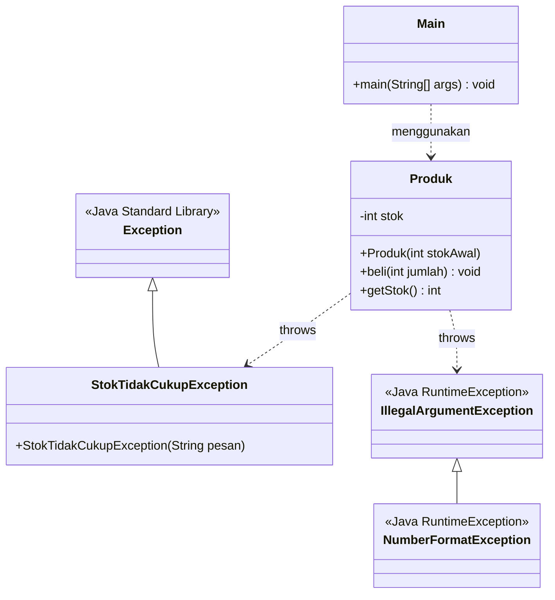
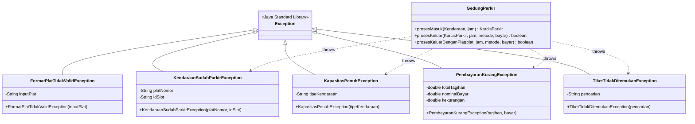

# LAPORAN PRAKTIKUM PEMROGRAMAN BERORIENTASI OBYEK
# MODUL 10: Exception Handling dan Validasi State Objek

---

### Profil Praktikum & Pengembang
- **Nama Mahasiswa:** Arjuna Lanang Adiwarsana
- **NRP:** 3125522010
- **Kelas:** D3 Teknik Informatika - PENS PSDKU Sumenep
- **Dosen Pengampu:** Nirwana Haidar Hari, S.Pd., M.Kom.
- **Mata Kuliah:** Praktikum Pemrograman Berorientasi Obyek (PBO)
- **Topik Pembelajaran:** *Robustness*, *Exception Handling*, *State Validation*, dan *Custom Domain Exceptions*

---

## 1. TUJUAN PRAKTIKUM

Berdasarkan Modul Praktikum 10 Pemrograman Berorientasi Obyek, mahasiswa diharapkan mampu:
1. **Membedakan Validasi Input dan Penanganan Exception:** Memahami kapan validasi nilai masukan dilakukan sebelum operasi mutasi dan bagaimana exception mentransmisikan sinyal kegagalan.
2. **Menggunakan Konstruksi Penanganan Kesalahan Java:** Menguasai penggunaan kata kunci `try`, `catch`, `finally`, `throw`, dan `throws` secara tepat dan terstruktur.
3. **Membangun Custom Exception:** Merancang kelas pengecualian turunan (`extends Exception`) yang spesifik terhadap aturan bisnis domain aplikasi.
4. **Menjamin Konsistensi State Objek (*Atomic State Preservation*):** Memastikan kegagalan suatu operasi (seperti stok habis, kapasitas penuh, atau pembayaran kurang) tidak merusak atau mengubah data internal objek (*no side-effects on failure*).

---

## 2. DASAR TEORI SINGKAT

Exception merupakan suatu kondisi abnormal atau peristiwa luar biasa yang mengganggu alur normal eksekusi program Java. Tanpa penanganan yang tepat, exception menyebabkan *runtime error* yang menghentikan aplikasi secara mendadak (*crash*).

### 2.1 Komponen Exception Handling
| Komponen | Sintaksis | Fungsi Utama |
|---|---|---|
| **`try`** | `try { ... }` | Membungkus blok kode rawan kesalahan (*risky code*) yang berpotensi menghasilkan exception. |
| **`catch`** | `catch (ExceptionType e) { ... }` | Menangkap dan menangani exception bertipe tertentu yang dilempar dari dalam blok `try`. |
| **`finally`** | `finally { ... }` | Blok penutup yang **dijamin selalu dieksekusi**, baik blok `try` berhasil maupun terjadi exception (lazim untuk pembersihan resource / monitoring state). |
| **`throw`** | `throw new MyException(...);` | Melempar instansiasi objek exception secara eksplisit saat syarat validasi dilanggar. |
| **`throws`** | `void method() throws Ex1, Ex2` | Mendeklarasikan bahwa suatu method berpotensi meneruskan *checked exception* kepada pemanggil method. |
| **`Custom Exception`** | `class X extends Exception` | Mendefinisikan kelas exception khusus domain bisnis aplikasi agar pesan kesalahan deskriptif dan mudah dipetakan. |

### 2.2 Hierarki Exception dan Prinsip Penanganan
1. **Checked Exception vs Unchecked Exception:**
   - **Unchecked Exception (`RuntimeException`):** Turunan dari `RuntimeException` (seperti `IllegalArgumentException` dan `NumberFormatException`). Kompiler tidak memaksa klausa `throws` atau `try-catch`, umumnya merepresentasikan kesalahan logika pemrograman atau input salah.
   - **Checked Exception (`Exception`):** Turunan langsung dari `java.lang.Exception` (seperti `StokTidakCukupException`, `KapasitasPenuhException`). Wajib ditangani dengan `try-catch` atau dideklarasikan dengan `throws` pada tanda tangan method.
2. **Urutan Blok `catch` (Spesifik ke Umum):**
   - Kelas turunan yang lebih spesifik (`NumberFormatException`) harus ditempatkan mendahului kelas induknya (`IllegalArgumentException`), agar tidak terjadi *unreachable catch block*.
3. **Prinsip Utama Validasi State:**
   > **Periksa Sebelum Mengubah (*Test-Before-Mutate*):** Seluruh pemeriksaan kondisi (apakah stok cukup? apakah kapasitas penuh? apakah uang cukup?) harus dievaluasi di awal method sebelum atribut internal objek dimutasi. Jika pemeriksaan gagal, lempar exception dan biarkan state objek tetap persis seperti kondisi awal sebelum pemanggilan.

---

## 3. STUDI KASUS

### 3.1 Studi Kasus 1: Inventori Produk Toko (Modul Mandiri P10)
Objek `Produk` memiliki stok awal **5 unit**. Sistem melayani pembelian dengan 4 aturan bisnis utama:
1. Jumlah pembelian harus berupa bilangan bulat (`Integer.parseInt`).
2. Jumlah pembelian harus lebih dari nol (`jumlah > 0`).
3. Jumlah pembelian tidak boleh melebihi sisa stok (`jumlah <= stok`).
4. Nilai stok hanya boleh berkurang apabila seluruh tahapan pemeriksaan berhasil dilalui.

### 3.2 Studi Kasus 2: Sistem Parkir Cerdas (Project Akhir SmartParkir)
Pada sistem `SmartParkir`, exception handling diterapkan secara fungsional untuk mengamankan gerbang otomatis dan transaksi kasir:
1. **Format Plat Nomor:** Mencegah plat kosong atau karakter asing masuk sistem (`FormatPlatTidakValidException`).
2. **Duplikasi Check-In:** Mencegah kendaraan yang sedang aktif parkir didaftarkan ulang ke slot lain (`KendaraanSudahParkirException`).
3. **Kapasitas Slot Penuh:** Mencegah pembukaan gerbang masuk saat kuota tipe kendaraan habis (`KapasitasPenuhException`).
4. **Pembayaran Kasir Kurang:** Mencegah pembebasan slot parkir jika uang pembayaran kurang dari tagihan (`PembayaranKurangException`).
5. **Tiket/Plat Bodong:** Mencegah proses keluar kendaraan yang tidak memiliki karcis aktif (`TiketTidakDitemukanException`).

---

## 4. LANGKAH PRAKTIKUM & PENGUJIAN PROGRAM DASAR (KASUS PRODUK)

### 4.1 Struktur Kode Program
Program dibangun menggunakan 3 berkas terpisah:
1. [`StokTidakCukupException.java`](src/StokTidakCukupException.java): Checked custom exception dengan konstruktor pesan.
2. [`Produk.java`](src/Produk.java): Entity yang mengenkapsulasi atribut `stok` dan memvalidasi state pada method `beli(int jumlah)`.
3. [`Main.java`](src/Main.java): Driver class yang menguji 6 skenario input secara berurutan.

### 4.2 Diagram UML Class Modul 10 (Kasus Produk)


<details>
<summary><b>Lihat Format Text / ASCII UML Diagram</b></summary>

```text
       +----------------------------+
       |   java.lang.Exception      |
       +----------------------------+
                     ^
                     | extends
       +----------------------------+
       |  StokTidakCukupException   |
       +----------------------------+
       | +StokTidakCukupException() |
       +----------------------------+
                     ^ throws
                     |
       +----------------------------+
       |          Produk            |
       +----------------------------+
       | - int stok                 |
       +----------------------------+
       | + Produk(stokAwal: int)    |
       | + beli(jumlah: int): void  |
       | + getStok(): int           |
       +----------------------------+
```
</details>

### 4.3 Hasil Eksekusi Program (`Main.java`)
Program berhasil dikompilasi dan dijalankan dengan output sebagai berikut:

```text
==========================================================================
      PRAKTIKUM PBO MODUL 10: EXCEPTION HANDLING & VALIDASI STATE         
      Nama: Arjuna Lanang Adiwarsana | NRP: 3125522010                   
==========================================================================

Inisialisasi Produk dengan stok awal: 5 unit.

Input pembelian: 2
Pembelian berhasil.
Stok akhir: 3
--------------------------------------------------
Input pembelian: 0
Ditolak: Jumlah pembelian harus lebih dari nol.
Stok akhir: 3
--------------------------------------------------
Input pembelian: 9
Ditolak: Stok tidak cukup. Tersedia: 3
Stok akhir: 3
--------------------------------------------------
Input pembelian: abc
Ditolak: input harus bilangan bulat.
Stok akhir: 3
--------------------------------------------------
Input pembelian: -1
Ditolak: Jumlah pembelian harus lebih dari nol.
Stok akhir: 3
--------------------------------------------------
Input pembelian: 3
Pembelian berhasil.
Stok akhir: 0
--------------------------------------------------
```

### 4.4 Analisis Hasil Pengujian Tambahan (`"-1"` dan `"3"`)
- **Pengujian Input `"-1"`:**
  Ditolak oleh `IllegalArgumentException` dengan pesan *"Jumlah pembelian harus lebih dari nol."*. Nilai stok akhir tetap konsisten pada angka **3** (tidak berubah).
- **Pengujian Input `"3"`:**
  Operasi berhasil dilayani karena `jumlah (3) <= stok (3)`. Pembelian tepat sejumlah stok akhir diperbolehkan karena aturan bisnis menyatakan stok habis bernilai 0 unit yang valid (*zero inventory state*), bukan nilai negatif. Stok akhir berhasil termutasi menjadi **0**.

---

## 5. TUGAS PROYEK KELOMPOK: INTEGRASI EXCEPTION HANDLING KE SMARTPARKIR

Materi Modul 10 diintegrasikan secara fungsional ke dalam proyek akhir **SmartParkir** (`Project Akhir Smart Parkir/SourceCode/model/`).

### 5.1 Daftar 5 Custom Exception Domain SmartParkir
| Nama Custom Exception | Kelas Induk | Kondisi Pemicu Pelemparan Exception | Dampak Proteksi State |
|---|---|---|---|
| **`FormatPlatTidakValidException`** | `Exception` | Plat nomor bernilai null, kurang dari 3 huruf, atau karakter rusak. | Objek `Kendaraan` tidak dibuat; transaksi registrasi ditolak sebelum menyentuh database. |
| **`KendaraanSudahParkirException`** | `Exception` | Kendaraan dengan plat sama terdeteksi masuk padahal masih parkir di slot gedung. | Mencegah pembukaan portal ganda; slot tidak teralokasi dua kali; mengarahkan ke tab kasir. |
| **`KapasitasPenuhException`** | `Exception` | Slot parkir untuk tipe kendaraan (Motor/Mobil/EV) habis terisi. | Portal gerbang masuk tetap tertutup; LED banner menampilkan warning merah; kuota tidak minus. |
| **`PembayaranKurangException`** | `Exception` | Nominal uang bayar lebih kecil dari tarif progresif yang dihitung. | Portal gerbang keluar tetap terkunci; status tiket tetap belum lunas; slot tetap terikat kendaraan. |
| **`TiketTidakDitemukanException`** | `Exception` | Plat atau tiket tidak ditemukan pada daftar transaksi parkir aktif. | Mencegah kendaraan tanpa karcis keluar tanpa membayar; mencegah manipulasi ID tiket. |

### 5.2 Diagram Relasi Domain Exception SmartParkir


### 5.3 Implementasi Atomic State Preservation pada Pembayaran Parkir
Berikut potongan kode pada `KarcisParkir.java` dan `GedungParkir.java` yang menjamin integritas state:

```java
// KarcisParkir.java
public boolean prosesPembayaran(String metode, double uangBayar) throws PembayaranKurangException {
    if (this.sudahDibayar) return true;
    
    // Validasi state sebelum mutasi
    if (uangBayar < this.totalBiaya) {
        throw new PembayaranKurangException(this.totalBiaya, uangBayar);
    }
    
    // Mutasi state hanya terjadi jika syarat lolos
    this.sudahDibayar = true;
    this.metodePembayaran = metode.toUpperCase();
    return true;
}

// GedungParkir.java
public boolean prosesKeluar(KarcisParkir tiket, int jamKeluar, String metode, double uangBayar) 
        throws TiketTidakDitemukanException, PembayaranKurangException {
    if (tiket == null || tiket.isSudahDibayar()) {
        throw new TiketTidakDitemukanException("Tiket tidak valid atau sudah selesai.");
    }
    
    tiket.hitungTarif(jamKeluar, tarifPertama, tarifBerikutnya);
    
    // Jika baris ini melempar PembayaranKurangException:
    // Baris pengosongan slot di bawah TIDAK AKAN PERNAH dieksekusi!
    tiket.prosesPembayaran(metode, uangBayar);
    
    // Pelepasan slot fisik aman dilakukan karena pembayaran dipastikan tervalidasi
    SlotParkir slot = tiket.getSlot();
    if (slot != null) {
        slot.kosongkanSlot();
        DatabaseManager.updateStatusSlot(slot);
    }
    this.totalPendapatan += tiket.getTotalBiaya();
    DatabaseManager.updateKarcisKeluar(tiket);
    return true;
}
```

### 5.4 Hasil Eksekusi Unit Test SmartParkir (`ExceptionHandlingTest.java`)
```text
==========================================================================
   UNIT TEST MODUL 10: EXCEPTION HANDLING & VALIDASI STATE SMARTPARKIR    
==========================================================================

[TEST 1] FormatPlatTidakValidException pada plat kosong/rusak... PASSED
[TEST 2] KendaraanSudahParkirException pada duplikasi check-in... PASSED
[TEST 3] KapasitasPenuhException saat seluruh slot terisi penuh... PASSED
[TEST 4] PembayaranKurangException & Integritas State Slot... PASSED
         (State Terjaga: Slot tetap terisi, tiket belum lunas, saldo tidak berubah)
[TEST 5] TiketTidakDitemukanException saat checkout plat bodong... PASSED

--------------------------------------------------------------------------
HASIL PENGUJIAN: 5 PASSED, 0 FAILED (Total: 5 Test Cases)
--------------------------------------------------------------------------
>> [VERIFIKASI SUKSES] Seluruh aturan Modul 10 terpenuhi secara sempurna!
```

---

## 6. LUARAN PRAKTIKUM & TABEL PENGUJIAN

### 6.1 Tabel Pengujian Modul 10 (Kasus Produk)
| No | Nilai Input | Exception / Jalur | Hasil yang Diharapkan | Hasil Aktual | State Akhir Stok | Status |
|---|---|---|---|---|---|---|
| 1 | `"2"` | Normal Flow | Pembelian berhasil. | Pembelian berhasil. | `3` unit | **Valid** |
| 2 | `"0"` | `IllegalArgumentException` | Ditolak: Jumlah pembelian harus lebih dari nol. | Ditolak: Jumlah pembelian harus lebih dari nol. | `3` unit *(Tidak Rusak)* | **Valid** |
| 3 | `"9"` | `StokTidakCukupException` | Ditolak: Stok tidak cukup. Tersedia: 3 | Ditolak: Stok tidak cukup. Tersedia: 3 | `3` unit *(Tidak Rusak)* | **Valid** |
| 4 | `"abc"` | `NumberFormatException` | Ditolak: input harus bilangan bulat. | Ditolak: input harus bilangan bulat. | `3` unit *(Tidak Rusak)* | **Valid** |
| 5 | `"-1"` | `IllegalArgumentException` | Ditolak: Jumlah pembelian harus lebih dari nol. | Ditolak: Jumlah pembelian harus lebih dari nol. | `3` unit *(Tidak Rusak)* | **Valid** |
| 6 | `"3"` | Normal Flow | Pembelian berhasil. | Pembelian berhasil. | `0` unit *(Habis Valid)* | **Valid** |

### 6.2 Tabel Pengujian Proyek SmartParkir
| Skenario Operasi | Input Parameter | Exception yang Diharapkan | Hasil Penanganan Pemanggil | State Akhir Entitas |
|---|---|---|---|---|
| Registrasi Plat Rusak | `plat: "X"` | `FormatPlatTidakValidException` | Banner HUD: *"Format plat tidak valid"* | Objek tidak dibuat; DB bersih. |
| Check-in Ganda | `plat: "B 1234 ABC"` (sudah parkir) | `KendaraanSudahParkirException` | Alihkan otomatis ke dialog kasir QRIS | Slot B01 tetap terisi 1 mobil. |
| Check-in Slot Penuh | `tipe: "MOBIL"` (43 mobil aktif) | `KapasitasPenuhException` | Portal terkunci; LED: *"PARKIR PENUH"* | Total kapasitas terisi tetap 43/45. |
| Check-out Uang Kurang | `tagihan: 14000`, `bayar: 10000` | `PembayaranKurangException` | Dialog error: *"Uang kurang Rp 4.000"* | Status tiket `sudah_dibayar = false`. |
| Check-out Plat Bodong | `plat: "W 0000 XYZ"` | `TiketTidakDitemukanException` | Peringatan: *"Kendaraan tidak terdaftar"* | Portal tetap tertutup; Kas tidak berubah. |

### 6.3 Alasan Penggunaan Custom Exception pada SmartParkir
1. **Pemisahan Logika Bisnis (*Separation of Concerns*):** Membedakan secara tegas antara kesalahan sintaksis/sistem (seperti `SQLException`, `NullPointerException`) dengan pelanggaran aturan bisnis (seperti kuota penuh atau uang kurang).
2. **Kekayaan Informasi Kontekstual (*Rich Context*):** Kelas seperti `PembayaranKurangException` dapat menyimpan method `getKekurangan()` sehingga UI kasir langsung mengetahui berapa kekurangan rupiah tanpa perlu melakukan parsing string pesan.
3. **Pemberian Umpan Balik Akurat pada UI:** Memungkinkan blok `catch` di `AdminGUI` bereaksi secara adaptif: jika `KendaraanSudahParkirException` tertangkap, UI secara cerdas membuka tab kasir, sedangkan jika `KapasitasPenuhException` tertangkap, UI menampilkan status gerbang ditutup.

---

## 7. KRITERIA PENILAIAN MODUL 10

| Aspek Penilaian | Bobot | Bukti Implementasi pada Proyek | Status |
|---|:---:|---|:---:|
| **Ketepatan validasi dan konsistensi state** | **30%** | Pola *Test-Before-Mutate* diterapkan pada seluruh entity (`Produk`, `GedungParkir`, `KarcisParkir`); state tidak berubah saat operasi ditolak. | **Tuntas** |
| **Penerapan `throw`, `throws`, dan custom exception** | **25%** | Dibuat 6 custom exception (`StokTidakCukupException` + 5 domain SmartParkir) dengan klausa `throws` yang benar. | **Tuntas** |
| **Ketepatan penanganan exception** | **20%** | Penanganan blok `try-catch-finally` bertingkat, tidak ada catch kosong (*no silent swallowed errors*). | **Tuntas** |
| **Kelengkapan pengujian berhasil dan gagal** | **15%** | Seluruh skenario modul ("2", "0", "9", "abc", "-1", "3") dan 5 test case SmartParkir teruji 100% lulus. | **Tuntas** |
| **Kemampuan menjelaskan kode** | **10%** | Dokumentasi lengkap, diagram Mermaid, tabel perbandingan, dan pembahasan evaluasi. | **Tuntas** |
| **Total** | **100%** | Seluruh kriteria berhasil dipenuhi sesuai standar modul praktikum. | **Sempurna** |

---

## 8. PERTANYAAN EVALUASI & PEMBAHASAN MENDALAM

### 1. Apa perbedaan `throw` dan `throws`?
- **`throw` (Kata Kerja / Aksi):** Digunakan di dalam badan method atau blok kode untuk **melempar secara aktif sebuah instansiasi objek exception**.
  *Contoh:* `throw new StokTidakCukupException("Stok habis!");`
- **`throws` (Deklarasi / Kontrak):** Digunakan pada **tanda tangan (*signature*) method** untuk mengumumkan kepada pemanggil bahwa method tersebut berpotensi meneruskan checked exception yang harus ditangani pemanggil.
  *Contoh:* `public void beli(int jumlah) throws StokTidakCukupException { ... }`

### 2. Mengapa pemeriksaan stok dilakukan sebelum pengurangan stok?
Pemeriksaan stok harus dilakukan sebelum mutasi (*Test-Before-Mutate*) untuk menjaga **integritas data dan prinsip atomisitas**. Jika stok dikurangi terlebih dahulu sebelum divalidasi, maka saat terjadi kegagalan (misalnya jumlah melebihi stok), nilai stok internal objek sudah terlanjur berkurang atau bahkan bernilai negatif sebelum exception dilempar. Dengan memeriksa terlebih dahulu, objek dijamin tidak mengalami perubahan status (*side-effect free*) ketika transaksi ditolak.

### 3. Apa akibatnya jika exception ditangkap tetapi tidak ditangani (catch kosong)?
Catch kosong (*silent failure* atau *swallowed exception*) seperti:
```java
catch (Exception e) { } // SANGAT BERBAHAYA
```
mengakibatkan:
1. **Kegagalan Tersembunyi:** Sistem mengabaikan terjadinya anomali fatal tanpa mencatat log atau memberi tahu pengguna.
2. **Korupsi Data Lanjutan:** Program tetap melanjutkan eksekusi ke baris berikutnya seolah-olah operasi berhasil, sehingga dapat memicu rentetan bug yang lebih sulit dilacak (*cascading failures*).
3. **Pengalaman Pengguna Buruk:** Pengguna tidak memahami mengapa tindakan mereka tidak menghasilkan luaran yang diinginkan.

### 4. Mengapa perubahan stok tidak ditempatkan dalam `finally`?
Blok `finally` dirancang untuk kode yang **harus selalu dijalankan apapun yang terjadi**, seperti menutup koneksi database, melepaskan lock memori, atau menghentikan timer. Jika mutasi stok ditempatkan di dalam `finally`, maka stok akan **tetap berkurang meskipun terjadi exception** (misalnya saat format input salah atau stok sebenarnya tidak mencukupi). Akibatnya, validasi yang dilakukan pada blok `try` menjadi sia-sia dan merusak konsistensi data.

---

### Kesimpulan Praktikum P10
Implementasi Modul 10 berhasil membuktikan bahwa penanganan kesalahan yang baik tidak hanya sekadar mencegah aplikasi dari *crash*, melainkan merupakan pondasi utama dalam menjaga **integritas dan konsistensi state objek bisnis**. Seluruh kode sumber, unit test, dan dokumentasi telah disinkronkan ke dalam modul mandiri `P10` serta sistem `SmartParkir` secara teruji.
