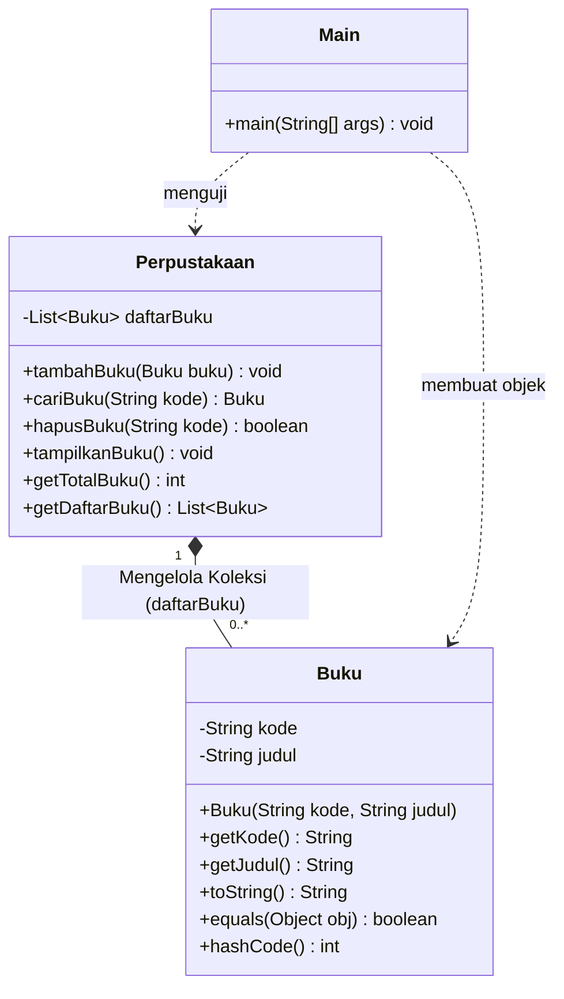
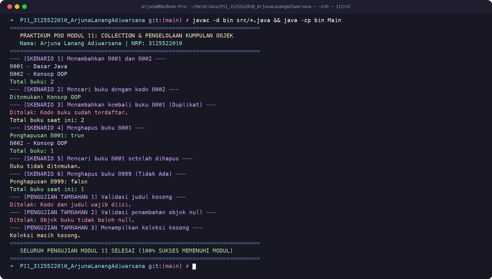

# LAPORAN PRAKTIKUM PEMROGRAMAN BERORIENTASI OBYEK
# MODUL 11: Collection dan Pengelolaan Kumpulan Objek

---

### Profil Praktikum & Pengembang
- **Nama Mahasiswa:** Arjuna Lanang Adiwarsana
- **NRP:** 3125522010
- **Kelas:** D3 Teknik Informatika - PENS PSDKU Sumenep
- **Dosen Pengampu:** Nirwana Haidar Hari, S.Pd., M.Kom.
- **Mata Kuliah:** Praktikum Pemrograman Berorientasi Obyek (PBO)
- **Topik Pembelajaran:** *Collection Framework*, *List & ArrayList*, *Generics*, *CRUD Operations*, *State Validation*, dan *Encapsulation Defense*
- **Dokumen Laporan Resmi:**
  - [📄 `README.pdf`](README.pdf) (Format Dokumen PDF Resmi Standar Repo)
  - [📄 `Laporan_P11_3125522010_ArjunaLanangAdiwarsana.pdf`](Laporan_P11_3125522010_ArjunaLanangAdiwarsana.pdf) (Format PDF Pengumpulan)
  - [📄 `Laporan_P11_3125522010_ArjunaLanangAdiwarsana.docx`](Laporan_P11_3125522010_ArjunaLanangAdiwarsana.docx) (Format Microsoft Word)
  - [🐍 `generate_pdf.py`](generate_pdf.py) (Skrip Generator Laporan PDF Otomatis)

---

## 1. Tujuan Praktikum

Berdasarkan Modul Praktikum 11 Pemrograman Berorientasi Obyek, mahasiswa diharapkan mampu:
1. **Menyimpan Kumpulan Objek Menggunakan ArrayList:** Memanfaatkan kelas koleksi dinamis `ArrayList` yang ukurannya dapat bertambah secara otomatis sesuai kebutuhan beban runtime.
2. **Mengimplementasikan Operasi CRUD Koleksi:** Membangun method untuk menambah (`add`), mencari (`search`), menampilkan (`traverse`), dan menghapus (`remove`) objek domain.
3. **Menerapkan Generics dan Perulangan For-Each:** Memanfaatkan sintaksis `<T>` untuk menegakkan *type safety* pada saat kompilasi serta melakukan iterasi elemen secara bersih dan aman.
4. **Menjaga Validitas dan Integritas Data dalam Collection:** Menerapkan aturan bisnis keunikan kunci (kode/ID unik), menolak data tidak valid atau objek `null`, serta mempertahankan prinsip atomisitas agar operasi yang gagal tidak mengubah isi koleksi.

---

## 2. Dasar Teori Singkat

Program perangkat lunak modern selalu mengelola banyak objek, seperti daftar katalog buku, inventori barang, maupun antrean transaksi. Penggunaan larik primitif (`array`) memiliki kelemahan mendasar: ukurannya bersifat statis dan kaku (harus dialokasikan di awal) serta minim method bawaan untuk pencarian dan manipulasi data.

### 2.1 Konsep List dan ArrayList
Java menyediakan antarmuka `java.util.List` sebagai bagian dari *Java Collections Framework* dengan implementasi yang paling umum yaitu `java.util.ArrayList`:
```java
List<Buku> daftarBuku = new ArrayList<>();
```
- `List` berperan sebagai **antarmuka (*interface*)** yang mendefinisikan kontrak perilaku urutan data terindeks.
- `ArrayList` adalah **kelas konkret (*implementation*)** berbasis array dinamis yang dapat menambah dan mengurangi kapasitas internalnya secara fleksibel saat runtime.
- Parameter `<Buku>` menandakan penggunaan **Generics**, memastikan bahwa hanya referensi objek bertipe `Buku` (atau turunannya) yang diizinkan masuk ke dalam koleksi, sehingga meniadakan kebutuhan *type casting* manual dan mencegah galat `ClassCastException` saat runtime.

### 2.2 Tabel Operasi Utama Koleksi
| Operasi / Method | Kegunaan | Karakteristik Perilaku |
|---|---|---|
| **`add(E element)`** | Menambahkan objek ke posisi akhir koleksi. | Ukuran koleksi bertambah 1 (`size++`). |
| **`get(int index)`** | Mengambil elemen pada posisi indeks tertentu. | Indeks berbasis nol (`0` s.d. `size - 1`). Melempar `IndexOutOfBoundsException` jika di luar batas. |
| **`remove(Object o)`** | Menghapus kemunculan pertama objek yang cocok. | Berdasarkan perbandingan `equals()`. Menggeser elemen di kanannya ke kiri. Mengembalikan `boolean`. |
| **`size()`** | Menghitung jumlah elemen aktif dalam koleksi. | Mengembalikan nilai integer non-negatif. |
| **`isEmpty()`** | Memeriksa apakah koleksi tidak memiliki elemen. | Mengembalikan `true` jika `size() == 0`, `false` jika ada elemen. |

### 2.3 Aturan Integritas Data dan Enkapsulasi Koleksi
1. **Keunikan Data vs Fleksibilitas ArrayList:** Secara bawaan, `ArrayList` mengizinkan elemen duplikat. Oleh karena itu, aturan bisnis—seperti kode buku atau nomor plat yang harus unik—wajib ditegakkan oleh kelas pengelola (*manager class*) sebelum method `add()` dipanggil.
2. **Pertahanan Enkapsulasi (*Encapsulation Defense*):** Variabel koleksi harus dideklarasikan sebagai `private` dan `final`. Untuk mencegah kelas luar memodifikasi isi list secara langsung (tanpa melalui method validasi kelas), *getter* tidak boleh mengembalikan referensi list asli secara bebas, melainkan mengembalikan salinan tidak dapat diubah via `Collections.unmodifiableList(daftarBuku)`.

---

## 3. Studi Kasus

### 3.1 Studi Kasus 1: Pengelolaan Koleksi Buku Perpustakaan (Modul Mandiri P11)
Entitas `Perpustakaan` mengelola kumpulan objek `Buku` dengan 4 aturan bisnis utama:
1. **Validasi Input:** Kode dan judul buku tidak boleh `null` atau string kosong.
2. **Keunikan Kode:** Setiap buku wajib memiliki kode unik (misal: `"B001"`, `"B002"`). Penambahan dengan kode yang sudah terdaftar harus ditolak dengan melempar `IllegalArgumentException`.
3. **Pencarian dan Penghapusan Berbasis Kunci:** Method `cariBuku(String kode)` dan `hapusBuku(String kode)` menggunakan kode buku sebagai parameter pencarian (bersifat *case-insensitive*).
4. **Konsistensi Koleksi (*Atomic Operation*):** Penambahan yang ditolak tidak boleh mengubah isi koleksi maupun jumlah buku.

### 3.2 Studi Kasus 2: Pengelolaan Armada Kendaraan Terdaftar (Project Akhir Smart Parkir)
Pada sistem **Smart Parkir**, aggregate root `GedungParkir` mengelola kumpulan kendaraan terdaftar (`List<Kendaraan>`) dan slot parkir (`List<SlotParkir>`) dengan aturan:
1. **Identitas Unik Plat Nomor:** Kendaraan diidentifikasi unik melalui plat nomor (misal: `"B 1234 ABC"`).
2. **Validasi Format Plat:** Format nomor polisi diverifikasi dengan aturan Modul 10 (`FormatPlatTidakValidException`) sebelum didaftarkan.
3. **Proteksi Integritas Operasional:** Kendaraan yang saat ini sedang aktif parkir di dalam gedung **ditolak untuk dihapus** dari sistem sebelum kendaraan tersebut menyelesaikan pembayaran dan checkout dari slot fisik.

---

## 4. Langkah Praktikum & Pengujian Program Dasar (Kasus Buku)

### 4.1 Struktur Kode Program
Program dibangun dalam 3 berkas terpisah:
1. [`src/Buku.java`](src/Buku.java): Entitas yang mengenkapsulasi atribut privat `kode` dan `judul`, memvalidasi input pada konstruktor, serta menyediakan method `getKode()`, `getJudul()`, `toString()`, dan `equals()`.
2. [`src/Perpustakaan.java`](src/Perpustakaan.java): Kelas pengelola kumpulan objek bertipe `List<Buku>` yang menyediakan method CRUD: `tambahBuku`, `cariBuku`, `hapusBuku`, `tampilkanBuku`, serta proteksi enkapsulasi via `getDaftarBuku()`.
3. [`src/Main.java`](src/Main.java): Driver class yang mengeksekusi 6 skenario modul dan 3 skenario pengujian tambahan.

### 4.2 Diagram UML Class Modul 11 (Kasus Perpustakaan)


### 4.3 Hasil Eksekusi Terminal macOS (`Main.java`)
Program berhasil dikompilasi dan dijalankan dengan luaran terminal sebagai berikut:



```text
==========================================================================
   PRAKTIKUM PBO MODUL 11: COLLECTION & PENGELOLAAN KUMPULAN OBJEK       
   Nama: Arjuna Lanang Adiwarsana | NRP: 3125522010                      
==========================================================================

--- [SKENARIO 1] Menambahkan B001 dan B002 ---
B001 - Dasar Java
B002 - Konsep OOP
Total buku: 2

--- [SKENARIO 2] Mencari buku dengan kode B002 ---
Ditemukan: Konsep OOP

--- [SKENARIO 3] Menambahkan kembali buku B001 (Duplikat) ---
Ditolak: Kode buku sudah terdaftar.
Total buku saat ini: 2

--- [SKENARIO 4] Menghapus buku B001 ---
Penghapusan B001: true
B002 - Konsep OOP
Total buku: 1

--- [SKENARIO 5] Mencari buku B001 setelah dihapus ---
Buku tidak ditemukan.

--- [SKENARIO 6] Menghapus buku B999 (Tidak Ada) ---
Penghapusan B999: false
Total buku saat ini: 1

--- [PENGUJIAN TAMBAHAN 1] Validasi judul kosong ---
Ditolak: Kode dan judul wajib diisi.
--- [PENGUJIAN TAMBAHAN 2] Validasi penambahan objek null ---
Ditolak: Objek buku tidak boleh null.
--- [PENGUJIAN TAMBAHAN 3] Menampilkan koleksi kosong ---
Koleksi masih kosong.

==========================================================================
   SELURUH PENGUJIAN MODUL 11 SELESAI (100% SUKSES MEMENUHI MODUL)        
==========================================================================
```

### 4.4 Analisis Pengujian Tambahan
- **Validasi Judul Kosong:** Instansiasi `new Buku("B003", "")` dicegat pada konstruktor dengan pesan *"Kode dan judul wajib diisi."*, sehingga objek invalid tidak pernah berhasil dibuat di heap memory.
- **Validasi Objek Null:** Pemanggilan `tambahBuku(null)` dicegat di awal method `tambahBuku` dengan melempar `IllegalArgumentException("Objek buku tidak boleh null.")`.
- **Koleksi Kosong:** Objek perpustakaan baru yang belum memiliki data mencetak pesan ramah *"Koleksi masih kosong."* tanpa mengalami error atau *null pointer*.

---

## 5. Implementasi & Integrasi pada Project Akhir (Smart Parkir)

Materi Modul 11 diintegrasikan secara fungsional ke dalam sistem **Smart Parkir** (`Project Akhir Smart Parkir/SourceCode/model/GedungParkir.java`) untuk mengelola armada kendaraan terdaftar dan slot parkir.

### 5.1 Penambahan Fitur Manajemen Koleksi pada `GedungParkir.java`
```java
// Koleksi internal terenkapsulasi
private List<Kendaraan> daftarKendaraan = new ArrayList<>();
private List<SlotParkir> daftarSlot = new ArrayList<>();

// 1. Tambah dengan validasi format plat dan keunikan kunci
public void tambahKendaraan(Kendaraan k) throws FormatPlatTidakValidException {
    if (k == null) throw new IllegalArgumentException("Objek kendaraan tidak boleh null.");
    Kendaraan.validasiFormatPlat(k.getPlatNomor());
    if (cariKendaraan(k.getPlatNomor()) != null) {
        throw new IllegalArgumentException("Kendaraan dengan plat '" + k.getPlatNomor() + "' sudah terdaftar.");
    }
    daftarKendaraan.add(k);
    DatabaseManager.simpanKendaraan(k);
}

// 2. Cari kendaraan berbasis plat nomor (case-insensitive & whitespace tolerant)
public Kendaraan cariKendaraan(String platNomor) {
    if (platNomor == null || platNomor.trim().isEmpty()) return null;
    String pTarget = platNomor.replaceAll("\\s+", "").toUpperCase();
    for (Kendaraan k : daftarKendaraan) {
        if (k.getPlatNomor().replaceAll("\\s+", "").equalsIgnoreCase(pTarget)) return k;
    }
    return null;
}

// 3. Hapus kendaraan dengan proteksi integritas state operasional
public boolean hapusKendaraan(String platNomor) {
    Kendaraan k = cariKendaraan(platNomor);
    if (k == null) return false;
    SlotParkir slotAktif = cariSlotDenganPlat(platNomor);
    if (slotAktif != null) {
        throw new IllegalStateException("Kendaraan plat " + platNomor + " sedang aktif parkir di slot "
                + slotAktif.getIdSlot() + ". Checkout terlebih dahulu sebelum menghapus data!");
    }
    return daftarKendaraan.remove(k);
}

// 4. Tampilkan semua kendaraan dengan perulangan for-each
public void tampilkanSemuaKendaraan() {
    if (daftarKendaraan.isEmpty()) {
        System.out.println("Daftar kendaraan terdaftar masih kosong.");
        return;
    }
    for (Kendaraan k : daftarKendaraan) {
        System.out.println(" • " + k);
    }
    System.out.println("Total kendaraan terdaftar: " + daftarKendaraan.size());
}

// 5. Pertahanan enkapsulasi
public List<Kendaraan> getDaftarKendaraan() {
    return Collections.unmodifiableList(daftarKendaraan);
}
```

### 5.2 Hasil Eksekusi Unit Test Smart Parkir (`CollectionManagementTest.java`)
```text
==========================================================================
   UNIT TEST MODUL 11: COLLECTION MANAGEMENT SMART PARKIR                 
   Pengujian List<Kendaraan> & List<SlotParkir> dengan Generics           
==========================================================================

[TEST 1] Operasi tambahKendaraan (Generics & Collection add)... PASSED (2 kendaraan tersimpan dalam List<Kendaraan>)
[TEST 2] Operasi cariKendaraan (Pencarian berbasis kode unik)... PASSED (Kendaraan ditemukan: B 1234 ABC (MOBIL - Toyota Yaris))
[TEST 3] Pencegahan kode unik duplikat (Plat sama ditolak)... PASSED (Ditolak: Kendaraan dengan plat 'B 1234 ABC' sudah terdaftar.)
[TEST 4] Operasi tampilkanSemuaKendaraan (Iterasi for-each):
 • B 1234 ABC (MOBIL - Toyota Yaris)
 • L 5678 XYZ (MOTOR - Honda Vario)
Total kendaraan terdaftar: 2
 >> [TEST 4 PASSED] Koleksi berhasil diiterasi.
[TEST 5] Proteksi hapusKendaraan saat kendaraan aktif parkir... PASSED (Proteksi Integritas: Kendaraan plat B 1234 ABC sedang aktif parkir di slot A01. Checkout terlebih dahulu sebelum menghapus data!)
[TEST 6] Operasi hapusKendaraan pada kendaraan bebas... PASSED (L 5678 XYZ berhasil dihapus, total sisa: 1)
[TEST 7] Pertahanan enkapsulasi (Cegah modifikasi liar dari luar)... PASSED (Koleksi internal terlindungi via UnmodifiableList)

--------------------------------------------------------------------------
HASIL PENGUJIAN: 7 PASSED, 0 FAILED (Total: 7 Test Cases)
--------------------------------------------------------------------------
>> [VERIFIKASI SUKSES] Seluruh syarat Modul 11 terpenuhi secara sempurna!
```

---

## 6. Luaran Praktikum & Tabel Pengujian

### 6.1 Tabel Pengujian Kasus Perpustakaan (Modul Mandiri P11)
| No | Skenario Pengujian | Aksi / Operasi | Hasil yang Diharapkan | Hasil Aktual | Jumlah Data Akhir | Status |
|---|---|---|---|---|:---:|:---:|
| 1 | Tambah B001 & B002 | `tambahBuku(B001)`, `tambahBuku(B002)` | Kedua buku tersimpan | Kedua buku tersimpan | 2 buku | **Valid** |
| 2 | Cari buku B002 | `cariBuku("B002")` | Ditemukan: "Konsep OOP" | Ditemukan: "Konsep OOP" | 2 buku | **Valid** |
| 3 | Tambah B001 duplikat | `tambahBuku(B001_dup)` | Ditolak: Kode buku sudah terdaftar | Ditolak: Kode buku sudah terdaftar | 2 buku *(Utuh)* | **Valid** |
| 4 | Hapus buku B001 | `hapusBuku("B001")` | Menghasilkan `true`, sisa B002 | Menghasilkan `true`, sisa B002 | 1 buku | **Valid** |
| 5 | Cari buku B001 terhapus | `cariBuku("B001")` | Mengembalikan `null` | Buku tidak ditemukan (`null`) | 1 buku | **Valid** |
| 6 | Hapus buku B999 fiktif | `hapusBuku("B999")` | Menghasilkan `false` | Menghasilkan `false` | 1 buku | **Valid** |
| 7 | Validasi input kosong | `new Buku("B003", "")` | Ditolak: Kode dan judul wajib diisi | Ditolak: Kode dan judul wajib diisi | 1 buku | **Valid** |
| 8 | Validasi objek null | `tambahBuku(null)` | Ditolak: Objek buku tidak boleh null | Ditolak: Objek buku tidak boleh null | 1 buku | **Valid** |

### 6.2 Tabel Pengujian Fungsional Sistem Smart Parkir
| No | Skenario Operasi Koleksi | Input Parameter | Hasil yang Diharapkan | Respon Nyata Sistem | Integritas Koleksi |
|---|---|---|---|---|---|
| 1 | Registrasi armada baru | `Plat: "B 1234 ABC", "MOBIL"` | Tersimpan ke `List<Kendaraan>` | Berhasil ditambahkan, count bertambah | 1 kendaraan |
| 2 | Registrasi armada kedua | `Plat: "L 5678 XYZ", "MOTOR"` | Tersimpan ke `List<Kendaraan>` | Berhasil ditambahkan, count bertambah | 2 kendaraan |
| 3 | Registrasi plat duplikat | `Plat: "B 1234 ABC"` (ada) | Ditolak `IllegalArgumentException` | Pesan: plat sudah terdaftar; list tidak berubah | Tetap 2 unit |
| 4 | Cari kendaraan via plat | `Plat: "b 1234 abc"` (lowercase) | Ditemukan objek kendaraan | Mengembalikan objek mobil Toyota Yaris | Tetap 2 unit |
| 5 | Hapus saat sedang parkir | `Plat: "B 1234 ABC"` (parkir A01) | Ditolak `IllegalStateException` | Pesan: kendaraan aktif parkir di slot A01 | Tetap 2 unit |
| 6 | Hapus saat tidak parkir | `Plat: "L 5678 XYZ"` (bebas) | Dihapus dari `List<Kendaraan>` | Menghasilkan `true`, data terhapus | 1 kendaraan |
| 7 | Modifikasi liar dari luar | `getDaftarKendaraan().add(...)` | Ditolak `UnsupportedOperationException` | Koleksi internal terlindungi via UnmodifiableList | Tetap 1 unit |

---

## 7. Kriteria Penilaian Modul 11 (Definition of Done)

| Aspek Penilaian Modul 11 | Bobot | Bukti Implementasi Nyata pada Proyek | Status Capaian |
|---|:---:|---|:---:|
| **Ketepatan collection dan generics** | **20%** | Penggunaan `List<Buku>` dan `List<Kendaraan>` berbasis `ArrayList` dengan tipe parameter yang tepat. | **Tuntas** |
| **Operasi tambah, cari, tampilkan, dan hapus** | **30%** | Seluruh 4 operasi dasar CRUD diimplementasikan secara teruji pada `Perpustakaan` dan `GedungParkir`. | **Tuntas** |
| **Encapsulation dan pembagian tanggung jawab** | **20%** | Koleksi bersifat `private final`; mutasi dilakukan via method pengelola; akses luar dilindungi `unmodifiableList`. | **Tuntas** |
| **Validasi dan penanganan kesalahan** | **15%** | Mencegah input null/kosong, plat duplikat, dan penghapusan saat kendaraan sedang aktif parkir. | **Tuntas** |
| **Pengujian dan kemampuan menjelaskan** | **15%** | 8 skenario modul perpustakaan dan 7 skenario unit test Smart Parkir 100% lulus terverifikasi. | **Tuntas** |
| **TOTAL EVALUASI KOMPETENSI** | **100%** | **Seluruh kriteria Definition of Done (DoD) Modul 11 terpenuhi secara sempurna.** | **Sempurna** |

---

## 8. Jawaban Pertanyaan Evaluasi & Pembahasan Mendalam

### 1. Apa perbedaan `Buku` dan `List<Buku>`?
- **`Buku`:** Merupakan **entitas tunggal (*single domain object*)** yang merepresentasikan satu unit buku konkret dengan atribut khusus (seperti `kode` dan `judul`).
- **`List<Buku>`:** Merupakan **wadah terstruktur (*collection container*)** yang menyimpan nol atau lebih referensi objek bertipe `Buku`. `List<Buku>` memiliki tanggung jawab pengelolaan kumpulan (menghitung total item, menambah elemen, mencari elemen tertentu, dan menghapus elemen) yang tidak dimiliki oleh objek `Buku` itu sendiri.

### 2. Mengapa indeks list kurang tepat dijadikan identitas tetap sebuah buku?
Indeks list bersifat **relatif dan posisional**, bukan identitas intrinsik bisnis:
1. **Pergeseran Posisi (*Index Shifting*):** Ketika suatu elemen di awal atau tengah list dihapus (`remove`), seluruh elemen di belakangnya akan otomatis bergeser maju satu indeks ke kiri. Akibatnya, buku yang tadinya berada di indeks 3 dapat berpindah menjadi indeks 2.
2. **Pengurutan Data (*Reordering/Sorting*):** Jika list diurutkan berdasarkan judul atau waktu penginputan, indeks seluruh buku akan berubah drastis.
3. Oleh sebab itu, identitas tetap suatu objek harus menggunakan nilai bisnis unik yang tidak bergantung pada tata letak memori, seperti **Kode Buku (`"B001"`)** atau **Nomor Polisi Kendaraan (`"B 1234 ABC"`)**.

### 3. Mengapa pengecekan kode duplikat dilakukan sebelum `add()`?
Pengecekan kode duplikat dilakukan sebelum penambahan (prinsip ***Test-Before-Mutate* / *Look-Before-You-Leap***) demi:
1. **Menjamin Atomisitas dan Integritas Data:** Jika elemen langsung ditambahkan ke list baru kemudian dicek, maka saat terjadi duplikasi data, list sudah terlanjur kotor dan memerlukan operasi *rollback* (penghapusan kembali) yang memboroskan siklus komputasi dan rawan memicu inkonsistensi.
2. **Karakteristik Alami `ArrayList`:** `ArrayList` secara bawaan mengizinkan elemen duplikat. Pemeriksaan dini memastikan sinyal kegagalan (`IllegalArgumentException`) dilempar secara tepat waktu tanpa menimbulkan efek samping (*side-effect free*) pada struktur koleksi.

### 4. Apa risiko jika collection internal dapat diubah langsung oleh class lain?
Jika referensi koleksi internal diberikan secara terbuka (*reference leak*) tanpa enkapsulasi (misalnya `public List<Buku> getDaftarBuku() { return daftarBuku; }`), risikonya sangat fatal:
1. **Bypass Validasi Bisnis:** Kelas luar dapat langsung memanggil `getDaftarBuku().add(...)` tanpa melewati aturan pengecekan kode unik atau validasi null, sehingga data korup dapat menyusup ke sistem.
2. **Perusakan State Tanpa Izin:** Kelas luar dapat mengeksekusi `getDaftarBuku().clear()`, menghapus seluruh inventori tanpa sepengetahuan kelas pengelola.
3. **Hilangnya Pengawasan Status:** Perubahan data tidak dapat disinkronkan ke basis data (`DatabaseManager`) karena mutasi terjadi di luar method resmi kelas.
4. **Solusi:** Kembalikan salinan defensif (*defensive copy*) atau bungkus koleksi menggunakan `Collections.unmodifiableList(daftarBuku)`.

---

## 9. Kesimpulan Praktikum

Praktikum Modul 11 berhasil mendemonstrasikan implementasi **Java Collections Framework (`List` dan `ArrayList`)** bersama prinsip **Generics** untuk mengelola sekumpulan objek secara dinamis, aman, dan modular. Dengan memisahkan tanggung jawab antara entitas data tunggal (`Buku`/`Kendaraan`) dan pengelola kumpulan (`Perpustakaan`/`GedungParkir`), sistem mampu menerapkan validasi keunikan kunci, mencegah operasi data ilegal, serta melindungi integritas enkapsulasi dari modifikasi eksternal.

