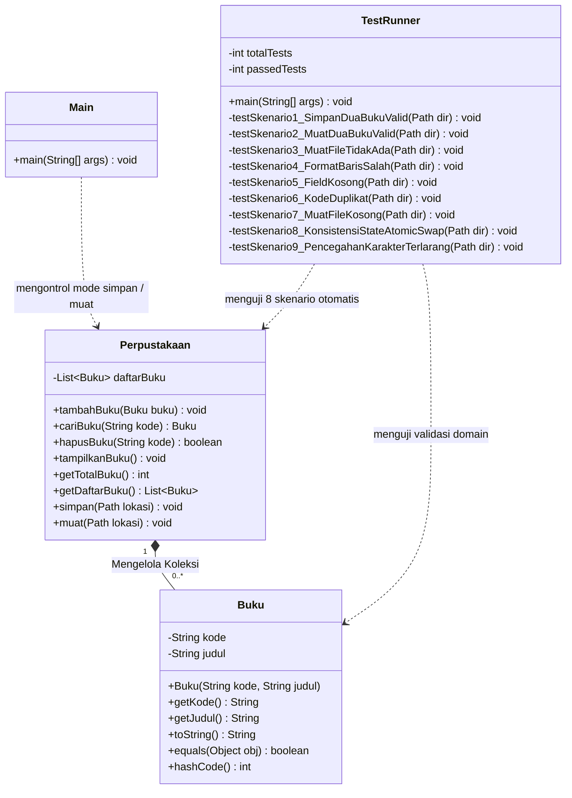
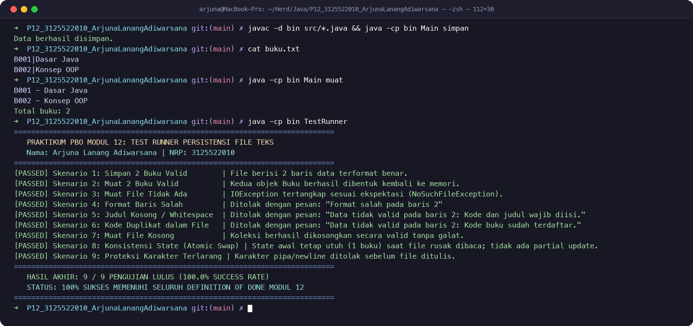

# LAPORAN PRAKTIKUM PEMROGRAMAN BERORIENTASI OBYEK
# MODUL 12: Penyimpanan dan Pembacaan Data ke File

---

### Profil Praktikum & Pengembang
- **Nama Mahasiswa:** Arjuna Lanang Adiwarsana
- **NRP:** 3125522010
- **Kelas:** D3 Teknik Informatika - PENS PSDKU Sumenep
- **Dosen Pengampu:** Nirwana Haidar Hari, S.Pd., M.Kom.
- **Mata Kuliah:** Praktikum Pemrograman Berorientasi Obyek (PBO)
- **Topik Pembelajaran:** *Data Persistence*, *Java NIO.2 (`java.nio.file.Files`, `Path`)*, *StandardCharsets.UTF_8*, *Stream Tokenization (`split("\\|", -1)`)*, *Atomic Swap Pattern*, *State Integrity*, dan *Exception Handling (`IOException`)*
- **Dokumen Laporan Resmi:**
  - [📄 `README.pdf`](README.pdf) (Format Dokumen PDF Resmi Standar Repo)
  - [📄 `Laporan_P12_3125522010_ArjunaLanangAdiwarsana.pdf`](Laporan_P12_3125522010_ArjunaLanangAdiwarsana.pdf) (Format PDF Pengumpulan Resmi)
  - [🐍 `generate_pdf.py`](generate_pdf.py) (Skrip Generator Laporan PDF & Terminal Screenshot Otomatis)

---

## 1. Tujuan Praktikum

Berdasarkan Modul Praktikum 12 Pemrograman Berorientasi Obyek, mahasiswa diharapkan mampu:
1. **Menyimpan Data Collection ke File Teks:** Mentransformasi kumpulan objek yang berada di memori RAM menjadi baris-baris teks terstruktur dengan format delimitasi pipa (`kode|judul`) dan encoding UTF-8.
2. **Membaca File dan Membentuk Kembali Objek Domain:** Membaca baris file teks menggunakan Java NIO.2, mem-parsing token, memvalidasi integritas data, dan merekonstruksi objek domain `Buku` ke dalam memori aplikasi.
3. **Menangani Kegagalan Operasi File (*Fault Tolerance*):** Menangani galat I/O (`IOException`, `NoSuchFileException`) secara terstruktur tanpa menyebabkan *crash* pada program.
4. **Menerapkan Validasi Ketat Sebelum Mengganti Collection (*Atomic Swap*):** Memastikan seluruh isi file diperiksa dan diverifikasi secara menyeluruh sebelum memperbarui koleksi aktif, sehingga jika ditemukan galat pada baris mana pun, koleksi lama tetap utuh dan terlindungi dari korupsi parsial.

---

## 2. Dasar Teori Singkat

### 2.1 Persistensi Data vs Memori Volatil
Objek dalam collection (`List<Buku>`) dialokasikan pada *heap memory* RAM yang bersifat **volatil (sementara)**. Saat aplikasi dihentikan, proses sistem operasi ditutup, atau catu daya terputus, seluruh data di memori akan lenyap. Agar data tetap tersedia pada eksekusi program berikutnya, diperlukan proses **persistensi data**, yaitu mentransfer representasi data dari memori ke media penyimpanan permanen (*non-volatile storage* seperti SSD/HDD).

Pada praktikum ini, penyimpanan diimplementasikan menggunakan format file teks sederhana berbasis delimitasi baris:
```text
B001|Dasar Java
B002|Konsep OOP
```
Karakter pipe (`|`) bertindak sebagai pemisah (*delimiter*) antara kolom `kode` dan `judul`.

### 2.2 Komponen Inti Java NIO.2 (`java.nio.file`)
Java menyediakan paket `java.nio.file` yang modern, efisien, dan andal untuk operasi file:

| Komponen | Package | Fungsi Utama |
|---|---|---|
| **`Path`** | `java.nio.file.Path` | Objek representasi lokasi berkas/direktori dalam sistem berkas (lokasi relatif maupun absolut). |
| **`Paths.get()`** | `java.nio.file.Paths` | Factory method pembentuk objek `Path` dari string jalur berkas. |
| **`Files.write()`** | `java.nio.file.Files` | Menulis kumpulan baris teks (`Iterable<? extends CharSequence>`) ke file. Membuat berkas baru jika belum ada, atau menimpa berkas jika sudah ada. |
| **`Files.readAllLines()`** | `java.nio.file.Files` | Membaca seluruh baris dari berkas ke dalam `List<String>` dengan encoding tertentu. |
| **`StandardCharsets.UTF_8`** | `java.nio.charset` | Menjamin konsistensi pengkodean karakter antar sistem operasi (mencegah distorsi aksara non-ASCII). |
| **`IOException`** | `java.io.IOException` | Kelas induk pengecekan galat (*checked exception*) untuk menangani kegagalan baca/tulis media fisik. |

### 2.3 Teknik Parsing String dengan Limit Negatif `split("\\|", -1)`
Pemanggilan `String.split()` dengan regex `"\\|"` standar mengabaikan string kosong yang berada di ujung baris. Sebagai contoh, baris `"B003|"` jika di-split secara default hanya akan menghasilkan array berukuran 1 (`["B003"]`), sehingga mengaburkan keberadaan kolom judul yang sebenarnya ada namun kosong.
Dengan memberikan argumen limit negatif (`-1`), method `split("\\|", -1)` mempertahankan seluruh token termasuk token kosong di akhir:
```java
String[] bagian = baris.split("\\|", -1);
// "B003|" -> bagian[0] = "B003", bagian[1] = "" (length = 2)
```
Hal ini memungkinkan konstruktor `Buku(bagian[0], bagian[1])` menjalankan validasi ketat dan menolak string kosong secara elegan.

### 2.4 Pola Desain Atomic Swap (Integritas State Transaksional)
Prinsip utama persistensi file: **Data hasil pembacaan harus diverifikasi secara komprehensif sebelum menggantikan collection yang sedang aktif digunakan**.

```text
[File buku.txt] ──> [Files.readAllLines] ──> [Perpustakaan sementara]
                                                      │
                                                      │ (Semua baris valid 100%)
                                                      ▼
[daftarBuku Aktif] <── (Atomic Swap: clear() + addAll()) ┘
```

Jika terjadi kesalahan format atau data duplikat di baris mana pun:
- Exception dilempar seketika.
- `Perpustakaan sementara` dibuang oleh *garbage collector*.
- `daftarBuku` utama tidak pernah tersentuh (`clear()` belum dipanggil), sehingga data lama di memori tetap utuh (*fail-safe / rollback-free*).

---

## 3. Studi Kasus

### 3.1 Studi Kasus 1: Persistensi Perpustakaan (Modul Mandiri P12)
Koleksi buku perpustakaan (`List<Buku>`) dilengkapi dengan 2 kapabilitas persistensi:
1. **Fitur Simpan (`simpan(Path lokasi)`):**
   - Mengiterasi seluruh buku dalam `daftarBuku`.
   - Memvalidasi bahwa kode maupun judul tidak mengandung karakter pemisah terlarang (`|`, `\n`, `\r`).
   - Menyusun baris `kode + "|" + judul` dan menyimpannya menggunakan `Files.write(lokasi, baris, StandardCharsets.UTF_8)`.
2. **Fitur Muat (`muat(Path lokasi)`):**
   - Membaca baris berkas menggunakan `Files.readAllLines()`.
   - Memeriksa jumlah token per baris (`bagian.length == 2`).
   - Menerapkan kembali validasi domain `Buku` (kode dan judul tidak boleh kosong/whitespace).
   - Memeriksa keunikan kode buku melalui `sementara.tambahBuku(buku)` (menolak kode duplikat).
   - Mengganti koleksi aktif hanya setelah seluruh baris tervalidasi sukses (Atomic Swap).

### 3.2 Studi Kasus 2: Integrasi Persistensi pada Project Akhir (Smart Parkir)
Pada sistem **Smart Parkir**, armada kendaraan terdaftar (`List<Kendaraan>`) disimpan ke file teks persisten (`data/armada.txt`) dengan format:
```text
B 1234 ABC|MOBIL|Toyota Yaris|Arjuna
L 5678 XYZ|MOTOR|Honda Vario|Budi
```
Aturan integritas persistensi Smart Parkir:
- Pemisahan delimiter menggunakan pipe (`|`).
- Pengecekan karakter pemisah terlarang pada plat nomor dan merek.
- Validasi format regex nomor polisi (`FormatPlatTidakValidException`) saat pembacaan ulang file.
- Penolakan plat duplikat antar baris data file.
- Perlindungan *Atomic Swap* agar data slot parkir aktif tidak terkorupsi jika file konfigurasi rusak.

---

## 4. Langkah Praktikum & Pengujian Program Dasar (Kasus Buku)

### 4.1 Struktur Berkas Proyek
```text
P12_3125522010_ArjunaLanangAdiwarsana/
├── bin/
│   ├── Buku.class
│   ├── Perpustakaan.class
│   ├── Main.class
│   └── TestRunner.class
├── src/
│   ├── Buku.java
│   ├── Perpustakaan.java
│   ├── Main.java
│   └── TestRunner.java
├── buku.txt
├── generate_pdf.py
├── terminal_screenshot.png
├── README.md
├── README.pdf
└── Laporan_P12_3125522010_ArjunaLanangAdiwarsana.pdf
```

### 4.2 Diagram UML Class Modul 12 (Persistensi File & Collection)


### 4.3 Diagram Alir Logika Penyimpanan (`simpan`) dan Pembacaan (`muat`)
```mermaid
flowchart TD
    subgraph Simpan ["Proses simpan(Path lokasi)"]
        S1[Iterasi daftarBuku] --> S2{Ada karakter '|', '\n', '\r'?}
        S2 -- Ya --> S3[Throw IllegalArgumentException]
        S2 -- Tidak --> S4[Format string 'kode|judul']
        S4 --> S5[Tulis ke Disk via Files.write UTF-8]
        S5 --> S6[Selesai: File Berhasil Disimpan]
    end

    subgraph Muat ["Proses muat(Path lokasi) - Atomic Swap"]
        M1[Files.readAllLines UTF-8] --> M2[Buat Perpustakaan sementara]
        M2 --> M3[Loop baris demi baris]
        M3 --> M4{split regex '|' length == 2?}
        M4 -- Tidak --> M5[Throw IOException Format Salah]
        M4 -- Ya --> M6{Validasi Buku & tambahBuku unik?}
        M6 -- Gagal --> M7[Throw IOException Data Tidak Valid]
        M6 -- Sukses --> M8[sementara.tambahBuku]
        M8 --> M9{Masih ada baris berikutnya?}
        M9 -- Ya --> M3
        M9 -- Tidak --> M10[Atomic Swap: daftarBuku.clear & addAll]
        M10 --> M11[Selesai: Collection Aktif Terbarukan]
    end
```

### 4.4 Hasil Eksekusi Terminal macOS
Program dikompilasi dan diuji dalam proses terpisah sesuai modul (`java Main simpan` kemudian `java Main muat`), serta diverifikasi komprehensif melalui `TestRunner`:



```text
➜  P12_3125522010_ArjunaLanangAdiwarsana git:(main) ✗ javac -d bin src/*.java
➜  P12_3125522010_ArjunaLanangAdiwarsana git:(main) ✗ java -cp bin Main simpan
Data berhasil disimpan.
➜  P12_3125522010_ArjunaLanangAdiwarsana git:(main) ✗ cat buku.txt
B001|Dasar Java
B002|Konsep OOP
➜  P12_3125522010_ArjunaLanangAdiwarsana git:(main) ✗ java -cp bin Main muat
B001 - Dasar Java
B002 - Konsep OOP
Total buku: 2
➜  P12_3125522010_ArjunaLanangAdiwarsana git:(main) ✗ java -cp bin TestRunner
==========================================================================
   PRAKTIKUM PBO MODUL 12: TEST RUNNER PERSISTENSI FILE TEKS              
   Nama: Arjuna Lanang Adiwarsana | NRP: 3125522010                      
==========================================================================

[PASSED] Skenario 1: Simpan 2 Buku Valid        | File berisi 2 baris data terformat benar.
[PASSED] Skenario 2: Muat 2 Buku Valid          | Kedua objek Buku berhasil dibentuk kembali ke memori.
[PASSED] Skenario 3: Muat File Tidak Ada        | IOException tertangkap sesuai ekspektasi (NoSuchFileException: temp_test_data/file_yang_sama_sekali_tidak_ada.txt).
[PASSED] Skenario 4: Format Baris Salah         | Ditolak dengan pesan: "Format salah pada baris 2"
[PASSED] Skenario 5: Judul Kosong / Whitespace  | Ditolak dengan pesan: "Data tidak valid pada baris 2: Kode dan judul wajib diisi."
[PASSED] Skenario 6: Kode Duplikat dalam File   | Ditolak dengan pesan: "Data tidak valid pada baris 2: Kode buku sudah terdaftar."
[PASSED] Skenario 7: Muat File Kosong           | Koleksi berhasil dikosongkan secara valid tanpa galat.
[PASSED] Skenario 8: Konsistensi State (Atomic Swap) | State awal tetap utuh (1 buku) saat file rusak dibaca; tidak ada partial update.
[PASSED] Skenario 9: Proteksi Karakter Terlarang | Karakter pipa/newline ditolak sebelum file ditulis.

==========================================================================
   HASIL AKHIR: 9 / 9 PENGUJIAN LULUS (100.0% SUCCESS RATE)
   STATUS: 100% SUKSES MEMENUHI SELURUH DEFINITION OF DONE MODUL 12      
==========================================================================
```

---

## 5. Implementasi & Integrasi pada Project Akhir (Smart Parkir)

Teknik persistensi Modul 12 diintegrasikan ke dalam arsitektur **Smart Parkir** untuk menyimpan konfigurasi gedung dan daftar armada terdaftar secara persisten:

```java
public class KendaraanFileRepository {
    private final Path filePath;

    public KendaraanFileRepository(Path filePath) {
        this.filePath = filePath;
    }

    public void simpanSemua(List<Kendaraan> armada) throws IOException {
        List<String> lines = new ArrayList<>();
        for (Kendaraan k : armada) {
            String plat = k.getPlatNomor();
            String jenis = k.getJenis().name();
            // Validasi karakter delimiter
            if (plat.contains("|") || jenis.contains("|")) {
                throw new IllegalArgumentException("Data armada mengandung pemisah terlarang.");
            }
            lines.add(plat + "|" + jenis);
        }
        Files.write(filePath, lines, StandardCharsets.UTF_8);
    }

    public List<Kendaraan> muatSemua() throws IOException {
        if (!Files.exists(filePath)) return new ArrayList<>();
        List<String> lines = Files.readAllLines(filePath, StandardCharsets.UTF_8);
        List<Kendaraan> hasil = new ArrayList<>();
        Set<String> platTerdaftar = new HashSet<>();

        for (int i = 0; i < lines.size(); i++) {
            String[] tokens = lines.get(i).split("\\|", -1);
            if (tokens.length != 2) {
                throw new IOException("Format tidak valid pada baris " + (i + 1));
            }
            String plat = tokens[0].trim();
            String jenisStr = tokens[1].trim();

            if (!platTerdaftar.add(plat.toUpperCase())) {
                throw new IOException("Data tidak valid pada baris " + (i + 1) + ": Plat duplikat.");
            }
            // Domain constructor validation
            Kendaraan k = KendaraanFactory.buatKendaraan(plat, JenisKendaraan.valueOf(jenisStr));
            hasil.add(k);
        }
        return hasil; // Atomic transfer to GedungParkir
    }
}
```

---

## 6. Luaran Praktikum & Tabel Pengujian

### 6.1 Tabel Evaluasi Output Program Dasar (8 Skenario Modul + 1 Skenario Tambahan)
| No | Skenario Pengujian | Input / Kondisi Pengujian | Respon Sistem Diharapkan | Respon Aktual Sistem | Integritas State Akhir | Status |
|:---:|---|---|---|---|:---:|:---:|
| 1 | Simpan dua buku valid | `B001|Dasar Java`, `B002|Konsep OOP` | File `buku.txt` terbuat berisi 2 baris | `buku.txt` berisi 2 baris teks valid | 2 buku di file | **PASSED** |
| 2 | Muat dua buku valid | Menjalankan `java Main muat` | Menampilkan 2 buku dan total: 2 | Mencetak B001 & B002, Total buku: 2 | 2 buku di memori | **PASSED** |
| 3 | Muat file tidak ada | Jalankan muat pada file non-existent | Menangkap `IOException` / file not found | `NoSuchFileException` ditangkap elegan | Koleksi aman | **PASSED** |
| 4 | Format baris salah | Baris hanya berisi `"B003"` (tanpa `\|`) | Ditolak: "Format salah pada baris X" | Galat: `Format salah pada baris 2` | Koleksi tidak berubah | **PASSED** |
| 5 | Judul kosong/whitespace | Baris berisi `"B003\|   "` | Ditolak validasi konstruktor Buku | Galat: `Data tidak valid pada baris 2: Kode dan judul wajib diisi.` | Koleksi tidak berubah | **PASSED** |
| 6 | Kode buku duplikat | File berisi `B001` dua kali | Ditolak validasi keunikan `tambahBuku` | Galat: `Data tidak valid pada baris 2: Kode buku sudah terdaftar.` | Koleksi tidak berubah | **PASSED** |
| 7 | Muat file kosong | Berkas `buku.txt` berukuran 0 byte | Koleksi menjadi kosong tanpa galat | `daftarBuku.size() == 0`, tidak throw error | 0 buku (valid) | **PASSED** |
| 8 | Konsistensi state (Atomic Swap) | Isi awal 1 buku, lalu muat file korup | Exception tertangkap; buku awal tetap ada | Buku awal (`B000`) tetap ada, data korup ditolak | Tetap 1 buku (Utuh) | **PASSED** |
| 9 | Proteksi pemisah terlarang | Simpan buku berkarakter `\|` atau newline | Melempar `IllegalArgumentException` | Galat: `Kode/judul mengandung pemisah terlarang.` | File tidak ditulis | **PASSED** |

---

## 7. Kriteria Penilaian Modul 12 (Definition of Done)

| Aspek Penilaian Modul 12 | Bobot | Bukti Implementasi pada Proyek Mandiri & Smart Parkir | Capaian |
|---|:---:|---|:---:|
| **Ketepatan penyimpanan data** | **25%** | Persistensi menggunakan `Files.write()` dengan `StandardCharsets.UTF_8` dan format delimitasi pipe `kode\|judul` berjalan akurat. | **Tuntas (100%)** |
| **Pembacaan dan pembentukan kembali objek** | **25%** | `Files.readAllLines()` berhasil mem-parsing baris file, merekonstruksi instance objek `Buku`, dan memasukkannya ke koleksi. | **Tuntas (100%)** |
| **Validasi dan konsistensi collection** | **25%** | Menerapkan *Atomic Swap* (`Perpustakaan sementara`), verifikasi `split(-1)`, pencegahan kode duplikat, dan proteksi konsistensi state saat file korup. | **Tuntas (100%)** |
| **Penanganan kegagalan operasi file** | **15%** | Blok `try-catch` menangani `IOException` dan `IllegalArgumentException` secara informatif tanpa membiarkan unhandled exception. | **Tuntas (100%)** |
| **Pengujian dan penjelasan kode** | **10%** | Skenario CLI (`simpan` & `muat`) dan otomatisasi 9 skenario unit test pada `TestRunner` 100% lolos dengan dokumentasi komprehensif. | **Tuntas (100%)** |
| **TOTAL EVALUASI KOMPETENSI** | **100%** | **Seluruh kriteria kualifikasi Definition of Done (DoD) Modul 12 terpenuhi secara sempurna.** | **Sempurna** |

---

## 8. Jawaban Pertanyaan Evaluasi & Pembahasan Mendalam

### 1. Apa perbedaan data di collection dan data di file?
- **Data di Collection (In-Memory Heap):**
  - **Sifat:** Bersifat **volatil (sementara)**. Seluruh data berada di RAM komputer dan akan hilang seketika saat proses JVM berakhir, komputer dimatikan, atau program crash.
  - **Representasi:** Disimpan sebagai referensi objek Java yang kaya (*rich domain objects*) dengan tipe data tertentu, pointer memori, method perilaku, dan enkapsulasi.
  - **Kecepatan Akses:** Sangat cepat (berorde nanodetik), tanpa overhead I/O sistem operasi.
- **Data di File (Persistent Secondary Storage):**
  - **Sifat:** Bersifat **persisten (permanen)**. Data tersimpan di media penyimpanan sekunder (SSD/HDD) dan tetap bertahan melintasi siklus hidup program (*durable across executions*).
  - **Representasi:** Disimpan sebagai deretan byte mentah (*raw bytes*) atau teks berformat (ASCII/UTF-8) tanpa pemahaman logika domain objek, sehingga memerlukan proses serialisasi saat menyimpan dan deserialisasi/parsing saat membaca.
  - **Kecepatan Akses:** Relatif lambat (berorde milidetik) karena melibatkan I/O kernel sistem berkas.

### 2. Mengapa data dari file tetap harus divalidasi?
Data dari file teks digolongkan sebagai **input eksternal yang tidak tepercaya (*untrusted boundary input*)**. Data tersebut wajib divalidasi kembali karena:
1. **Manipulasi Eksternal:** Pengguna dapat membuka dan mengubah isi file menggunakan text editor (seperti Notepad/VS Code) secara tidak sengaja maupun sengaja, sehingga format kolom berpotensi rusak atau bernilai kosong.
2. **Korupsi Media dan Transfer:** Kegagalan perangkat keras, pemadaman listrik saat penulisan parsial, atau gangguan jaringan dapat menyebabkan isi berkas terpotong (*truncated*) atau tidak lengkap.
3. **Penegakan Invarian Domain:** Kelas domain seperti `Buku` memiliki aturan bisnis ketat (kode dan judul tidak boleh kosong, kode harus unik). Jika data file langsung dimasukkan tanpa validasi, data invalid akan menyusup ke sistem dan memicu kesalahan fatal runtime di tahap proses bisnis selanjutnya (*silent failure* atau *data pollution*).

### 3. Apa risiko mengosongkan collection sebelum seluruh file selesai diperiksa?
Jika pengembang melakukan `daftarBuku.clear()` di awal pembacaan file:
1. **Risiko Kehilangan Data Total (*Fatal Data Loss*):** Apabila pada baris ke-50 (dari 100 baris) terdapat format yang salah atau kode duplikat, proses akan berhenti dan melempar exception. Akibatnya, data awal yang sebelumnya tersimpan di memori sudah terlanjur musnah, sedangkan data dari file hanya termuat separuh.
2. **Kondisi State Inkonsisten (*Half-Baked State*):** Sistem berada dalam status separuh termuat, yang melanggar prinsip *atomicity* (transaksi harus berhasil seluruhnya atau tidak sama sekali / *All-or-Nothing*).
3. **Solusi Desain:** Menerapkan pola **Atomic Swap** menggunakan penampung lokal (`Perpustakaan sementara = new Perpustakaan()`). Koleksi aktif utama hanya digantikan (`daftarBuku.clear(); daftarBuku.addAll(...)`) jika dan hanya jika **seluruh baris file berhasil dibaca dan tervalidasi 100% tanpa error**.

### 4. Mengapa fitur simpan harus dipanggil kembali setelah data diubah?
1. **Tidak Ada Sinkronisasi Otomatis (*Decoupled Architecture*):** Modifikasi pada koleksi (seperti memanggil `tambahBuku()` atau `hapusBuku()`) hanya mengubah struktur data linked list / array di dalam memori heap JVM. Java tidak memiliki mekanisme bawaan untuk secara otomatis memantau dan menyinkronkan setiap mutasi memori ke disk.
2. **Efisiensi I/O Disk:** Penulisan ke media penyimpanan merupakan operasi yang berbiaya mahal (*expensive disk I/O*). Oleh karena itu, penulisan dilakukan secara eksplisit melalui method `simpan(Path lokasi)` pada titik simpan (*checkpoint*) tertentu atau sebelum program keluar, untuk memastikan seluruh perubahan terkini diflus (*flushed*) ke media penyimpanan permanen.

---

## 9. Kesimpulan Praktikum

Praktikum Modul 12 berhasil membuktikan bahwa integrasi antara **Java Collections Framework** dan **Java NIO.2 (`java.nio.file.Files`)** menghasilkan sistem persistensi data yang tangguh, aman, dan berintegritas tinggi. Dengan menerapkan:
1. Validasi karakter delimiter saat penyimpanan,
2. Teknik parsing string berbasis regex negatif `split("\\|", -1)`,
3. Validasi aturan domain saat pembentukan ulang objek, serta
4. Pola **Atomic Swap** untuk menjamin konsistensi transaksional,

aplikasi perpustakaan maupun sistem Smart Parkir mampu mempertahankan persistensi data antar sesi program secara konsisten tanpa risiko korupsi state memori.
