# LAPORAN TUGAS AKHIR PRAKTIKUM PEMROGRAMAN BERORIENTASI OBYEK
# MODUL 15: AUDIT DESAIN SISTEM & EVALUASI ARSITEKTUR SMART PARKING TERINTEGRASI
**Politeknik Elektronika Negeri Surabaya (PENS) - PSDKU Sumenep**  
**Departemen Teknik Informatika dan Komputer**  

---

### Profil Mahasiswa & Pengembang Sistem
- **Nama Mahasiswa:** Arjuna Lanang Adiwarsana
- **NRP:** 3125522010
- **Program Studi:** D3 PJJ Teknik Informatika
- **Kampus:** PENS PSDKU Sumenep
- **Mata Kuliah:** Pemrograman Berorientasi Obyek (PBO)
- **Dosen Pengampu:** Nirwana Haidar Hari, S.Pd., M.Kom.
- **Tahun Akademik:** 2026 / Semester Ganjil
- **Fokus Modul 15:** *Software Architecture Audit*, *UML vs Code Parity Verification*, *Responsibility Driven Design (CRC)*, *Defensive Invariant Validation*, *Test Scenario Traces*, *Design Rationale*, *Technical Debt Ledger*, dan *UAS Oral Defense Preparation Guide*.

---

## 1. Eksekutif Ringkasan Desain (Executive Architecture Summary)

Modul 15 merepresentasikan fase **Audit Desain Final (Design Freeze & Architecture Verification)** terhadap seluruh ekosistem perangkat lunak **Smart Parking System 2.0**. Sistem ini mengintegrasikan seluruh capaian pembelajaran praktikum PBO dari Pertemuan 1 hingga Pertemuan 14:
1. **Pemodelan Berorientasi Objek & Enkapsulasi Ketat (P1 - P5):** State isolation, atribut private, setter/getter terkontrol, dan constructor invariants.
2. **Inheritance & Polimorfisme (P6 - P8):** Subtyping terstruktur, method overriding dinamis, dan generalisasi domain.
3. **Robustness & Domain Exception Handling (P10):** Hierarki custom exception (`FormatPlatTidakValidException`, `KapasitasPenuhException`, `KendaraanSudahParkirException`, `PembayaranKurangException`, `TiketTidakDitemukanException`).
4. **Collection Management & Dynamic Memory (P11):** List, Generic types, stream iteration, and encapsulation defense melalui `Collections.unmodifiableList()`.
5. **Data Persistence & File I/O (P12):** Java NIO.2, Atomic write, pipe-delimited serialization, and rehydration resilient terhadap kerusakan data.
6. **Penerapan Penuh SOLID Principles (P13):** SRP, OCP, LSP, ISP, dan DIP via Constructor Injection.
7. **Refactoring & Code Smells Elimination (P14):** Primitive Obsession removal, Value Object encapsulation, and Guard Clauses.

---

## 2. UML Class Diagram Representasi Final Terintegrasi

Diagram kelas berikut memetakan arsitektur lengkap sistem terintegrasi menggunakan notasi resmi Mermaid Class Diagram. Seluruh relasi struktural dinyatakan secara presisi (*Composition*, *Aggregation*, *Realization*, *Generalization*, dan *Dependency*):

```mermaid
classDiagram
    direction TB

    %% ==========================================
    %% INTERFACES (ROLE-BASED CONTRACTS / ISP & DIP)
    %% ==========================================
    class IParkingGateController {
        <<interface>>
        +isGerbangTerbuka() boolean
        +setStatusGerbang(boolean terbuka, String status) void
        +getStatusGerbang() String
        +tutupGerbang() void
    }

    class IParkingBilling {
        <<interface>>
        +hitungTagihan(KarcisParkir tiket, int jamKeluar, DiskonStrategy diskonStrategy) double
        +prosesKeluar(KarcisParkir tiket, int jamKeluar, IPaymentProcessor paymentProcessor, double uangBayar, DiskonStrategy diskonStrategy) boolean
        +cetakStrukKeluar(KarcisParkir tiket) void
    }

    class IArmadaManager {
        <<interface>>
        +tambahKendaraan(Kendaraan k) void
        +hapusKendaraan(String platNomor) boolean
        +tampilkanSemuaKendaraan() void
        +getDaftarKendaraan() List~Kendaraan~
        +getTotalKendaraanTerdaftar() int
    }

    class IKendaraanRepository {
        <<interface>>
        +simpan(Path lokasi) void
        +muat(Path lokasi) List~Kendaraan~
        +tambah(Kendaraan k) void
        +hapus(String plat) boolean
        +cari(String plat) Kendaraan
        +getSemua() List~Kendaraan~
    }

    class DiskonStrategy {
        <<interface>>
        +hitungDiskon(double totalBiayaKotor, Kendaraan k, int durasiJam) double
        +getNamaDiskon() String
    }

    class IPaymentProcessor {
        <<interface>>
        +prosesPembayaran(double jumlahBayar, double nominalDiterima) boolean
        +getMetodePembayaran() String
        +formatKuitansi(double tagihan, double bayar, double kembali) String
    }

    %% ==========================================
    %% AGGREGATE ROOT & DOMAIN CORE
    %% ==========================================
    class GedungParkir {
        -String namaGedung
        -List~SlotParkir~ daftarSlot
        -List~Kendaraan~ daftarKendaraan
        -List~KarcisParkir~ riwayatTransaksi
        -double tarifJamPertamaMobil
        -double tarifPerJamMobil
        -double tarifJamPertamaMotor
        -double tarifPerJamMotor
        -double totalPendapatan
        -int counterTiket
        -IKendaraanRepository kendaraanRepository
        -boolean gerbangTerbuka
        -String statusGerbang
        +tambahSlot(SlotParkir slot) void
        +hapusSlot(String idSlot) boolean
        +getSisaKuota(String tipeKendaraan) int
        +getSisaKuotaLantai(int lantai, String tipeKendaraan) int
        +prosesMasuk(Kendaraan k, int jamMasuk) KarcisParkir
        +prosesMasukTicketless(Kendaraan k, int jamMasuk) KarcisParkir
        +prosesMasukEmergency(String tipeKendaraan, int jamMasuk) KarcisParkir
        +cariTiketAktif(String query) KarcisParkir
        +cariTiketAktifDenganPlat(String plat) KarcisParkir
        +cariTiketAktifDenganSlot(String idSlot) KarcisParkir
        +getDaftarTiketAktif() List~KarcisParkir~
        +setKendaraanRepository(IKendaraanRepository repository) void
        +simpanArmadaKeFile() void
        +muatArmadaDariFile() int
    }

    class SlotParkir {
        -String idSlot
        -int lantai
        -String tipeSlot
        -boolean terisi
        -Kendaraan kendaraanParkir
        +cocokUntuk(Kendaraan k) boolean
        +isiSlot(Kendaraan k) boolean
        +kosongkanSlot() boolean
        +getIdSlot() String
        +getLantai() int
        +getTipeSlot() String
        +isTerisi() boolean
        +getKendaraanParkir() Kendaraan
    }

    class Kendaraan {
        -String platNomor
        -String tipe
        -String merk
        +validasiFormatPlat(String plat)$ void
        +getPlatNomor() String
        +getTipe() String
        +getMerk() String
        +isMobilListrik() boolean
    }

    class KarcisParkir {
        -String nomorTiket
        -Kendaraan kendaraan
        -SlotParkir slot
        -int jamMasuk
        -int jamKeluar
        -boolean sudahDibayar
        -double totalBiaya
        -double potonganDiskon
        -String namaDiskon
        -String metodePembayaran
        +hitungDurasi(int jamKeluarAktual) int
        +hitungTarif(int jamKeluarAktual, double tarifJamPertama, double tarifPerJam) double
        +tandaiLunas(String metode, double total, double diskon, String namaD) void
        +getNomorTiket() String
        +getKendaraan() Kendaraan
        +getSlot() SlotParkir
        +getJamMasuk() int
        +isSudahDibayar() boolean
        +getTotalBiaya() double
    }

    %% ==========================================
    %% STRATEGY IMPLEMENTATIONS (OCP / LSP)
    %% ==========================================
    class TanpaDiskonStrategy {
        +hitungDiskon(double total, Kendaraan k, int durasi) double
        +getNamaDiskon() String
    }
    class MemberVIPDiskonStrategy {
        +hitungDiskon(double total, Kendaraan k, int durasi) double
        +getNamaDiskon() String
    }
    class PromoWeekendDiskonStrategy {
        +hitungDiskon(double total, Kendaraan k, int durasi) double
        +getNamaDiskon() String
    }
    class EVIncentiveDiskonStrategy {
        +hitungDiskon(double total, Kendaraan k, int durasi) double
        +getNamaDiskon() String
    }

    %% ==========================================
    %% PAYMENT PROCESSORS & FACTORY
    %% ==========================================
    class CashPaymentProcessor {
        +prosesPembayaran(double tagihan, double nominal) boolean
        +getMetodePembayaran() String
        +formatKuitansi(double t, double b, double k) String
    }
    class EMoneyPaymentProcessor {
        +prosesPembayaran(double tagihan, double nominal) boolean
        +getMetodePembayaran() String
        +formatKuitansi(double t, double b, double k) String
    }
    class QRISPaymentProcessor {
        +prosesPembayaran(double tagihan, double nominal) boolean
        +getMetodePembayaran() String
        +formatKuitansi(double t, double b, double k) String
    }
    class VirtualAccountPaymentProcessor {
        +prosesPembayaran(double tagihan, double nominal) boolean
        +getMetodePembayaran() String
        +formatKuitansi(double t, double b, double k) String
    }
    class PaymentProcessorFactory {
        +createProcessor(String metode)$ IPaymentProcessor
    }

    %% ==========================================
    %% REPOSITORIES (DIP CONCRETE IMPLEMENTATIONS)
    %% ==========================================
    class KendaraanFileRepository {
        -Path pathPenyimpanan
        -List~Kendaraan~ bufferArmada
        +simpan(Path lokasi) void
        +muat(Path lokasi) List~Kendaraan~
        +tambah(Kendaraan k) void
        +hapus(String plat) boolean
        +cari(String plat) Kendaraan
        +getSemua() List~Kendaraan~
    }

    class InMemoryKendaraanRepository {
        -List~Kendaraan~ storageRAM
        +simpan(Path lokasi) void
        +muat(Path lokasi) List~Kendaraan~
        +tambah(Kendaraan k) void
        +hapus(String plat) boolean
        +cari(String plat) Kendaraan
        +getSemua() List~Kendaraan~
    }

    %% ==========================================
    %% DOMAIN CUSTOM EXCEPTIONS
    %% ==========================================
    class FormatPlatTidakValidException {
        -String platSalah
    }
    class KapasitasPenuhException {
        -String kategoriKendaraan
    }
    class KendaraanSudahParkirException {
        -String platNomor
        -String idSlot
    }
    class PembayaranKurangException {
        -double tagihan
        -double dibayar
        -double kekurangan
    }
    class TiketTidakDitemukanException {
        -String queryKarcis
    }

    %% ==========================================
    %% RELATIONSHIPS
    %% ==========================================
    IParkingGateController <|.. GedungParkir : realizes
    IParkingBilling <|.. GedungParkir : realizes
    IArmadaManager <|.. GedungParkir : realizes

    GedungParkir "1" *-- "0..*" SlotParkir : composition (lifecycle bound)
    GedungParkir "1" o-- "0..*" Kendaraan : aggregation (independent lifespan)
    GedungParkir "1" *-- "0..*" KarcisParkir : composition (transaction ledger)
    KarcisParkir "0..*" o-- "1" Kendaraan : references
    KarcisParkir "0..*" o-- "1" SlotParkir : references

    GedungParkir o-- IKendaraanRepository : depends on abstraction (DIP)
    IKendaraanRepository <|.. KendaraanFileRepository : implements
    IKendaraanRepository <|.. InMemoryKendaraanRepository : implements

    DiskonStrategy <|.. TanpaDiskonStrategy : implements
    DiskonStrategy <|.. MemberVIPDiskonStrategy : implements
    DiskonStrategy <|.. PromoWeekendDiskonStrategy : implements
    DiskonStrategy <|.. EVIncentiveDiskonStrategy : implements

    IPaymentProcessor <|.. CashPaymentProcessor : implements
    IPaymentProcessor <|.. EMoneyPaymentProcessor : implements
    IPaymentProcessor <|.. QRISPaymentProcessor : implements
    IPaymentProcessor <|.. VirtualAccountPaymentProcessor : implements

    PaymentProcessorFactory ..> IPaymentProcessor : instantiates
    GedungParkir ..> DiskonStrategy : executes via OCP
    GedungParkir ..> IPaymentProcessor : executes via OCP
    GedungParkir ..> PaymentProcessorFactory : uses
    GedungParkir ..> KapasitasPenuhException : throws
    GedungParkir ..> KendaraanSudahParkirException : throws
    GedungParkir ..> PembayaranKurangException : throws
    Kendaraan ..> FormatPlatTidakValidException : throws
```



---

## 3. Audit Konsistensi UML vs Implementasi (Code Parity Audit)

Audit ini memverifikasi kesesuaian antara pemodelan diagram UML dan implementasi nyata pada kode sumber Java (`.java`).

| Elemen UML | Definisi Model UML | Realisasi Java Source Code | Status Verifikasi | Catatan Audit & Kesesuaian |
| :--- | :--- | :--- | :---: | :--- |
| **GedungParkir** | Aggregate Root, private fields, public interface methods | `model/GedungParkir.java` (lines 30-490) | **100% MATCH** | Mengimplementasikan 3 interface ISP, merangkum slot parkir, riwayat karcis, dan kalkulasi tagihan. |
| **SlotParkir** | Entitas petak parkir fisik, enkapsulasi status `terisi` | `model/SlotParkir.java` (lines 7-120) | **100% MATCH** | Atribut `terisi` hanya bermutasi via `isiSlot()` dan `kosongkanSlot()`. Invariant tipe kendaraan terjaga. |
| **Kendaraan** | Domain model kendaraan, static validator format plat | `model/Kendaraan.java` (lines 7-95) | **100% MATCH** | Regex `^[A-Z]{1,2}\s*\d{1,4}(\s*[A-Z]{1,3})?$` memvalidasi format plat Indonesia standar. |
| **KarcisParkir** | Bukti transaksi agregasi kendaraan & slot | `model/KarcisParkir.java` (lines 11-160) | **100% MATCH** | Melindungi status `sudahDibayar`, menghitung durasi malam (modulo 24), dan mencatat detail audit diskon. |
| **Relasi: Gedung - Slot** | Composition (`GedungParkir *-- SlotParkir`) | `private List<SlotParkir> daftarSlot` di `GedungParkir` | **100% MATCH** | Slot dibuat dan dimiliki oleh gedung; slot tidak memiliki eksistensi mandiri tanpa gedung parkir. |
| **Relasi: Gedung - Kendaraan** | Aggregation (`GedungParkir o-- Kendaraan`) | `private List<Kendaraan> daftarKendaraan` | **100% MATCH** | Kendaraan tetap eksis secara independen di luar lingkungan gedung parkir (agregasi murni). |
| **Relasi: Gedung - Karcis** | Composition (`GedungParkir *-- KarcisParkir`) | `private List<KarcisParkir> riwayatTransaksi` | **100% MATCH** | Karcis diterbitkan dan diarsipkan secara terikat di dalam riwayat transaksi gedung parkir. |
| **Abstraksi: Repository** | Interface `IKendaraanRepository` (DIP) | `model/IKendaraanRepository.java` | **100% MATCH** | Memisahkan modul tinggi (`GedungParkir`) dari modul rendah (`KendaraanFileRepository`, `InMemory`). |
| **Strategi Diskon** | Interface `DiskonStrategy` (OCP/LSP) | 4 concrete class (`Tanpa`, `MemberVIP`, `Promo`, `EV`) | **100% MATCH** | Penambahan diskon baru (e.g., Flash Sale) tidak memerlukan modifikasi pada class `GedungParkir`. |
| **Prosesor Pembayaran** | Interface `IPaymentProcessor` & Factory | `model/IPaymentProcessor.java` & 4 impl | **100% MATCH** | Mendukung multi-metode pembayaran (Cash, E-Money, QRIS, VA) dengan kontrak validasi seragam. |
| **Domain Exceptions** | 5 Custom Exception bertipe Checked/Unchecked | 5 berkas file `*Exception.java` | **100% MATCH** | Menjamin fail-fast dan menangkal data korup/status ilegal sebelum mutasi state memori terjadi. |

> [!NOTE]
> **Hasil Audit Parity:** Tidak ditemukan *orphan class*, *shadow dependencies*, maupun disparitas atribut/method antara rancangan UML dan kode sumber Java. Rasio kesesuaian arsitektural adalah **100.0%**.

---

## 4. Audit Responsibility Matrix (CRC-Style per Class)

Pendekatan *Responsibility-Driven Design* memastikan setiap kelas memiliki tanggung jawab tunggal yang kohesif, mengetahui batasan datanya sendiri, serta mengamankan invariant internalnya.

| Kelas | What It Knows (State & Data) | What It Does (Behaviors & Responsibilities) | Invariants & Rules Guarded | Collaborators |
| :--- | :--- | :--- | :--- | :--- |
| `GedungParkir` | Nama gedung, tarif parkir per kategori, daftar slot, riwayat transaksi, status palang gerbang, total omzet | Mengorkestrasi masuk/keluar, mencari slot optimal (*waterfall floor allocation*), mendelegasikan pembayaran & diskon | • Kuota tidak boleh negatif<br/>• Gerbang hanya terbuka jika transaksi sah<br/>• Kendaraan parkir tidak boleh duplikat (Anti-Passback) | `SlotParkir`, `Kendaraan`, `KarcisParkir`, `IKendaraanRepository`, `DiskonStrategy`, `IPaymentProcessor` |
| `SlotParkir` | ID slot (e.g., "L1-A01"), nomor lantai, peruntukan tipe slot (`MOTOR`, `MOBIL`, `EV`), status okupansi | Menampung dan membebaskan kendaraan, mencocokkan kompatibilitas fisik slot dengan tipe kendaraan | • Slot `EV` eksklusif untuk mobil listrik<br/>• Slot terisi tidak boleh ditimpa kendaraan lain<br/>• Slot kosong tidak boleh dikosongkan ulang | `Kendaraan` |
| `Kendaraan` | Plat nomor polisi terdaftar, tipe klasifikasi, merk dagang, indikator mobil listrik | Menyediakan representasi identitas kendaraan, memvalidasi pola format nomor polisi via Regex | • Plat nomor minimal 3 karakter & sesuai format Samsat<br/>• Tipe wajib `MOTOR`, `MOBIL`, atau `MOBIL_LISTRIK`<br/>• Plat nomor immutable setelah instansiasi | `FormatPlatTidakValidException` |
| `KarcisParkir` | Nomor unik tiket, referensi kendaraan, referensi slot, jam masuk, jam keluar, total bayar, status lunas | Menghitung durasi jam parkir (termasuk melewati midnight), menghitung tagihan kotor, memvalidasi pelunasan | • Jam masuk/keluar berada dalam rentang [0..23]<br/>• Durasi minimum dihitung 1 jam (ceil rounding)<br/>• Karcis lunas tidak dapat dibayar ulang | `Kendaraan`, `SlotParkir` |
| `DiskonStrategy` | Parameter persentase atau voucher diskon | Menghitung potongan biaya berdasarkan aturan promo tanpa mengubah nilai tagihan pokok | • Nilai diskon tidak pernah menghasilkan net tagihan negatif<br/>• Nilai diskon dibatasi maksimal 100% subtotal | `Kendaraan` |
| `IPaymentProcessor` | Parameter verifikasi transaksi & format kuitansi | Memvalidasi kecukupan pembayaran, menghitung uang kembalian, menyusun struk transaksi | • Nominal pembayaran tunai tidak boleh lebih kecil dari tagihan<br/>• Metode non-tunai (QRIS/VA) diverifikasi tepat | `KarcisParkir` |
| `IKendaraanRepository` | Abstraksi kontrak persistence penyimpanan armada | Membaca, menyimpan, mencari, dan memfilter data kendaraan pada media persisten | • Operasi I/O tidak boleh merusak koleksi di RAM jika disk gagal (*atomic safety*) | `Kendaraan`, `Path` |
| `KendaraanFileRepository` | Path file teks fisik (`armada_kendaraan.txt`), buffer memori | Serialisasi format pipa (`plat\|tipe\|merk`) dan parsing rehidrasi baris teks | • Baris file teks korup dilewati tanpa menyebabkan fatal crash | `Kendaraan`, `Path` |

---

## 5. 4 Skenario Evaluasi Uji (Object Interaction Traces)

Pengujian komprehensif dilakukan untuk memverifikasi keandalan arsitektur dalam empat kondisi ekstrem: **Normal**, **Boundary**, **Invalid**, dan **Failure**.

### Skenario 1: Normal (Happy Path Checkout with Strategy & Gate Control)
- **Kondisi:** Pelanggan mengendarai Toyota Yaris (Plat `B 1010 PBO`), masuk pukul 08:00 WIB, parkir di slot `MBL-L1-01`, dan keluar pada pukul 11:00 WIB (durasi 3 jam) saat promo akhir pekan berlaku (diskon 10%).
- **Message Flow Trace:**
  ```mermaid
  sequenceDiagram
      autonumber
      actor Petugas as Operator / Kamera ANPR
      participant Gedung as GedungParkir
      participant Slot as SlotParkir (MBL-L1-01)
      participant Karcis as KarcisParkir (TKT-0001)
      participant Strategy as PromoWeekendDiskonStrategy
      participant Processor as CashPaymentProcessor

      Petugas->>Gedung: prosesMasuk(k, jamMasuk: 8)
      Gedung->>Gedung: cariSlotTersedia(k)
      Gedung->>Slot: isiSlot(k)
      Slot-->>Gedung: true (Slot Terkunci)
      Gedung->>Karcis: create("TKT-0001", k, slot, 8)
      Gedung->>Gedung: setStatusGerbang(true, "TERBUKA MASUK")
      Gedung-->>Petugas: KarcisParkir Diterbitkan

      Note over Petugas, Gedung: Kendaraan Parkir 3 Jam (08:00 - 11:00)

      Petugas->>Gedung: hitungTagihan(tiket, jamKeluar: 11, promoWeekend)
      Gedung->>Karcis: hitungDurasi(11) -> 3 Jam
      Gedung->>Karcis: hitungTarif(11, tarifAwal, tarifLanjut) -> Rp 11.000
      Gedung->>Strategy: hitungDiskon(11000, k, 3)
      Strategy-->>Gedung: Potongan Rp 1.100 (Diskon 10%)
      Gedung-->>Petugas: Tagihan Bersih: Rp 9.900

      Petugas->>Gedung: prosesKeluar(tiket, 11, cash, bayar: 10000, promoWeekend)
      Gedung->>Processor: prosesPembayaran(9900, 10000)
      Processor-->>Gedung: true (Kembalian: Rp 100)
      Gedung->>Karcis: tandaiLunas("CASH", 9900, 1100, "Promo Weekend 10%")
      Gedung->>Slot: kosongkanSlot()
      Slot-->>Gedung: true (Slot Bersih)
      Gedung->>Gedung: setStatusGerbang(true, "TERBUKA KELUAR")
      Gedung-->>Petugas: Checkout Sukses (Gerbang Terbuka)
  ```
- **Hasil Audit:** Status karcis berubah menjadi `sudahDibayar = true`, kuota slot kembali bertambah 1, omzet tercatat bertambah Rp 9.900 secara akurat.

---

### Skenario 2: Boundary (Nilai Batas & Titik Ekstrim)
- **Kondisi & Trace Interaksi:**
  1. **Durasi 0 Jam (Masuk 10:00, Keluar 10:00):** Method `hitungDurasi()` mendeteksi selisih 0, namun klausul invariant menetapkan durasi minimum parkir adalah 1 jam. Tagihan dihitung tepat sebesar tarif jam pertama (Rp 5.000).
  2. **Midnight Crossover (Masuk 23:00, Keluar 02:00):** Method `hitungDurasi()` mendeteksi `jamKeluar < jamMasuk`. Logika `(24 - jamMasuk) + jamKeluar` dieksekusi: `(24 - 23) + 2 = 3 Jam`. Tagihan dihitung tepat 3 jam tanpa menghasilkan durasi negatif.
  3. **Kapasitas Kritis (Sisa Kuota Tepat 1):** Slot mobil tersisa 1 unit. Mobil masuk menempati slot tersebut. Pemanggilan `getSisaKuota("MOBIL")` secara instan dan deterministik berubah dari 1 menjadi 0.
- **Hasil Audit:** Seluruh invariant batas (*boundary conditions*) terjaga sempurna tanpa memicu *arithmetic error* atau *index out of bounds*.

---

### Skenario 3: Invalid (Masukan Tidak Sah & Pelanggaran Aturan)
- **Kondisi & Trace Interaksi:**
  1. **Format Plat Ilegal (`X@#999`):** Diproses oleh `Kendaraan.validasiFormatPlat()`. Karakter spesial melanggar pola Regex. Sistem melempar `FormatPlatTidakValidException` dan membatalkan pembentukan objek.
  2. **Pembayaran Kurang (Underpayment):** Tagihan bersih Rp 11.000, pelanggan hanya menyerahkan uang tunai Rp 5.000. `CashPaymentProcessor` mendeteksi nominal tidak mencukupi dan melempar `PembayaranKurangException`. Karcis **tidak** ditandai lunas, slot **tidak** dibebaskan, dan palang keluar **tetap tertutup rapat**.
  3. **Pencarian Tiket Palsu (`TKT-NON-EXISTENT`):** Diproses oleh `GedungParkir.cariTiketAktif()`. Sistem mengembalikan nilai `null` secara aman tanpa melempar `NullPointerException` (menerapkan kontrak query defensif).
- **Hasil Audit:** Seluruh masukan ilegal tertahan di lapisan boundary tanpa mengotori integritas data internal.

---

### Skenario 4: Failure & Recovery (Fault Tolerance & Edge Case)
- **Kondisi & Trace Interaksi:**
  1. **Kapasitas 100% Penuh:** Slot terisi penuh. Kendaraan kedua mencoba masuk via `prosesMasuk()`. Sistem mendeteksi `slotTersedia == null`, melempar `KapasitasPenuhException`, dan menjaga palang masuk tetap `TERTUTUP / STANDBY`.
  2. **Anti-Passback (Plat Duplikat):** Kendaraan `B 1111 ABC` yang sedang parkir mencoba masuk kembali tanpa transaksi keluar sebelumnya. Diproses oleh `cariSlotDenganPlat()`. Sistem mendeteksi anomali dan melempar `KendaraanSudahParkirException`.
  3. **Kamera OCR Gagal Baca Plat:** Sistem mengaktifkan prosedur *Fail-Safe* via `prosesMasukEmergency()`. Tiket diterbitkan dengan format darurat `EMG-XXXX` dan slot tetap teralokasi secara sah.
  4. **Penyimpanan Disk Gagal (I/O Fault):** Dependency Inversion Principle memungkinkan penggantian runtime dari `KendaraanFileRepository` ke `InMemoryKendaraanRepository` melalui setter injection `setKendaraanRepository()`. Sistem tetap beroperasi tanpa henti (*zero downtime*) meskipun media disk bermasalah.
- **Hasil Audit:** Sistem terbukti *fault-tolerant*, resilient terhadap anomali eksternal, dan memiliki mekanisme *graceful degradation*.

---

## 6. 3 Keputusan Desain Penting & Rationale Arsitektural

### Keputusan 1: Pemisahan Role-Interface Ramping (ISP) pada Aggregate Root `GedungParkir`
- **Pilihan Alternatif:** Membuat interface monolitik tunggal `IParkingSystem` yang memuat lebih dari 30 method gabungan gate, billing, armada, dan persistence.
- **Keputusan Terpilih:** Memecah kontrak menjadi 3 *role interfaces* independen:
  1. `IParkingGateController`: Hanya mengekspos method operasional palang pintu gerbang bagi perangkat keras/IoT.
  2. `IParkingBilling`: Hanya mengekspos fungsi kalkulasi tagihan dan checkout kasir.
  3. `IArmadaManager`: Khusus mengelola koleksi data kendaraan member/armada operasional.
- **Alasan & Dampak Desain:** Menerapkan *Interface Segregation Principle* (ISP). Client subsistem gate controller tidak lagi dipaksa bergantung pada method billing atau laporan pendapatan. Hal ini menurunkan *coupling* dan mencegah *side-effect* saat salah satu modul dikembangkan lebih lanjut.

### Keputusan 2: Polimorfisme Strategi Diskon & Pembayaran Dinamis (OCP & LSP)
- **Pilihan Alternatif:** Menggunakan kontrol alur `switch(tipe)` atau rantai kondisional `if-else` bertingkat di dalam method `hitungTagihan()` dan `prosesKeluar()`.
- **Keputusan Terpilih:** Menerapkan **Strategy Pattern** melalui abstraksi `DiskonStrategy` dan `IPaymentProcessor`, serta **Factory Pattern** (`PaymentProcessorFactory`).
- **Alasan & Dampak Desain:** Menerapkan *Open-Closed Principle* (OCP). Ketika manajemen ingin menambahkan skema promo baru (misalnya "Promo Hari Kartini 50%" atau pembayaran via "Bank Mandiri VA"), pengembang cukup membuat satu class concrete baru tanpa mengubah satu baris pun kode stabil di `GedungParkir` maupun `KarcisParkir`. Kontrak *Liskov Substitution Principle* (LSP) menjamin bahwa setiap strategi diskon baru tidak akan pernah menghasilkan nilai tagihan minus.

### Keputusan 3: Injeksi Ketergantungan Persistensi melalui Abstraksi (DIP)
- **Pilihan Alternatif:** Melakukan instansiasi langsung `new KendaraanFileRepository()` atau menulis sintaks SQL JDBC langsung di dalam konstruktor `GedungParkir`.
- **Keputusan Terpilih:** Mengabstraksikan media penyimpanan ke dalam interface `IKendaraanRepository` dan menyuntikkannya ke `GedungParkir` melalui *Constructor Injection* dan *Setter Injection*.
- **Alasan & Dampak Desain:** Menerapkan *Dependency Inversion Principle* (DIP). Modul tingkat tinggi (logika bisnis parkir) tidak lagi terikat kaku pada modul tingkat rendah (sistem berkas OS atau database MySQL). Desain ini memungkinkan pengujian unit test berjalan secepat kilat (*lightning-fast deterministic test*) menggunakan `InMemoryKendaraanRepository` tanpa menyentuh disk fisik.

---

## 7. Daftar Technical Debt & Batasan Arsitektur (Design Freeze)

Fase *Design Freeze* mendokumentasikan batasan operasional sistem dan daftar hutang teknis yang sengaja ditunda agar ruang lingkup proyek tetap fokus dan stabil:

| No | Komponen / Fitur | Batasan Arsitektur Saat Ini | Risiko / Dampak Teknis | Rencana Mitigasi (Future Work) |
| :-: | :--- | :--- | :--- | :--- |
| **1** | Multi-Threading Concurrency | Manajemen slot dan transaksi dioperasikan secara *single-threaded* sinkron pada memori JVM. | Berpotensi terjadi *race condition* jika beberapa palang pintu masuk memicu alokasi slot secara simultan. | Implementasi `ReentrantLock` atau struktur koleksi *thread-safe* seperti `ConcurrentHashMap` dan `CopyOnWriteArrayList`. |
| **2** | State Synchronization Cache | Sinkronisasi antara RAM `GedungParkir` dan database relasional MySQL dilakukan via write-through ad-hoc di `DatabaseManager`. | Inkonsistensi data sementara jika terjadi pemadaman listrik saat query JDBC belum ter-commit. | Menerapkan Transaction Boundary (`conn.setAutoCommit(false)`) dengan pola *Unit of Work* dan recovery journal log. |
| **3** | Slot Allocation Heuristic | Alokasi slot menggunakan algoritma *first-fit waterfall* (mencari slot terendah yang cocok pertama kali). | Belum memperhitungkan jarak tempuh terpendek pengemudi ke pintu keluar lift (*optimal proximity routing*). | Peningkatan algoritma pencarian menggunakan *Weighted Graph Dijkstra* untuk rute parkir terdekat. |
| **4** | Offline Payment Verification | Integrasi QRIS dan Virtual Account pada simulasi lokal mengandalkan webhook mock callback. | Transaksi eksternal membutuhkan koneksi internet stabil ke Midtrans API gateway. | Penyediaan mode *Store-and-Forward* dengan verifikasi enkripsi kartu RFID offline jika jaringan internet putus. |

---

## 8. Panduan Oral Defense UAS (Tanya Jawab Kritis Dosen)

Panduan ini disusun secara sistematis untuk menjawab pertanyaan kritis penguji/dosen pada saat presentasi dan evaluasi lisan Ujian Akhir Semester (UAS):

### Pertanyaan 1: "Mengapa kelas `GedungParkir` memiliki relasi Komposisi dengan `SlotParkir`, tetapi memiliki relasi Agregasi dengan `Kendaraan`?"
> **Jawaban Komprehensif:**  
> "Relasi ini didasarkan pada siklus hidup (*lifecycle dependency*) dari entitas domain:
> 1. **Komposisi (`GedungParkir` *-- `SlotParkir`):** Slot parkir merupakan bagian integral dan fisik dari struktur bangunan gedung parkir itu sendiri. Slot tidak memiliki identitas maupun kegunaan fungsional jika gedung parkir tidak ada. Ketika objek `GedungParkir` dimusnahkan (*garbage collected*), seluruh objek `SlotParkir` di dalamnya secara logis ikut musnah.
> 2. **Agregasi (`GedungParkir` o-- `Kendaraan`):** Kendaraan adalah entitas luar independen. Kendaraan ada sebelum masuk ke gedung, dan tetap ada setelah keluar dari gedung. Kepemilikan gedung atas kendaraan bersifat sementara (*weak association/aggregation*). Menghapus objek `GedungParkir` tidak boleh menghapus data eksistensi kendaraan fisik pelanggan."

### Pertanyaan 2: "Mengapa `KarcisParkir` menyimpan referensi ke `Kendaraan` dan `SlotParkir`, bukan hanya menyimpan String plat nomor dan String ID slot?"
> **Jawaban Komprehensif:**  
> "Hal ini dilakukan untuk menjaga paradigma **Murni Berorientasi Objek** dan menghindari *anti-pattern Primitive Obsession*. Dengan menyimpan referensi objek:
> 1. Objek `KarcisParkir` dapat berkolaborasi langsung mengirimkan pesan (*message passing*) ke objek domain, seperti memanggil `kendaraan.isMobilListrik()` saat kalkulasi insentif hijau tanpa perlu melakukan *lookup* berulang ke koleksi global.
> 2. Memastikan integritas referensial: karcis terikat secara kuat pada objek slot fisik yang konkret, sehingga saat proses keluar, karcis dapat langsung menginstruksikan `slot.kosongkanSlot()` secara kohesif."

### Pertanyaan 3: "Invariant integritas apa yang paling kritis pada sistem ini dan bagaimana sistem Anda menjaminnya?"
> **Jawaban Komprehensif:**  
> "Terdapat 3 Invariant paling krusial:
> 1. **Invariant Okupansi Tunggal:** Satu slot parkir tidak boleh menampung lebih dari 1 kendaraan. Dijaga secara ketat oleh method `slot.isiSlot(k)` yang memeriksa flag `terisi`. Jika `terisi == true`, operasi mutasi ditolak seketika (*fail-safe*).
> 2. **Invariant Konsistensi Gerbang:** Palang pintu gerbang keluar tidak boleh terbuka jika karcis belum berstatus lunas. Dijaga oleh method `prosesKeluar()` yang mewajibkan transaksi pembayaran sukses di `IPaymentProcessor` sebelum mengeksekusi `setStatusGerbang(true, ...)` dan `slot.kosongkanSlot()`.
> 3. **Invariant Tarif Non-Negatif:** Net total biaya parkir tidak boleh bernilai negatif akibat penerapan diskon atau manipulasi jam. Dijaga melalui fungsi `Math.max(0.0, subtotal - diskon)` dan perhitungan durasi malam menggunakan formula modulo 24."

### Pertanyaan 4: "Bagaimana arsitektur ini membuktikan bahwa ia mematuhi Liskov Substitution Principle (LSP)?"
> **Jawaban Komprehensif:**  
> "Arsitektur ini mematuhi LSP karena seluruh subtipe implementor dari interface `DiskonStrategy` (`TanpaDiskonStrategy`, `MemberVIPDiskonStrategy`, `PromoWeekendDiskonStrategy`, `EVIncentiveDiskonStrategy`) dan `IPaymentProcessor` dapat saling menggantikan posisi satu sama lain pada pemanggilan method `GedungParkir.prosesKeluar()` tanpa merusak jalannya alur sistem. Tidak ada subtipe yang melempar exception tak terduga (*unexpected checked exception*), tidak ada yang memperketat pra-kondisi (*pre-conditions*), dan tidak ada yang memperlemah pasca-kondisi (*post-conditions*)."

### Pertanyaan 5: "Kapan Anda menggunakan Checked Exception vs Unchecked Exception dalam proyek ini?"
> **Jawaban Komprehensif:**  
> "Kami membaginya secara arsitektural:
> 1. **Checked Exception (turunan `java.lang.Exception`):** Digunakan untuk skenario kegagalan bisnis yang dapat diprediksi dan **harus diantisipasi serta dipulihkan** oleh pemanggil (*recoverable conditions*). Contoh: `KapasitasPenuhException` (operator harus mengarahkan kendaraan ke area lain), `PembayaranKurangException` (kasir meminta sisa uang), dan `FormatPlatTidakValidException` (pengguna diminta mengetik ulang).
> 2. **Unchecked Exception (turunan `java.lang.RuntimeException` / `IllegalArgumentException`):** Digunakan untuk pelanggaran kontrak pemrograman fatal atau *bug* logika pengembang (*programming errors/invariants*). Contoh: mengoper nilai `null` pada parameter kendaraan atau slot parkir, dan mempassing nilai lantai kurang dari 1."

---

## 9. Instruksi Kompilasi & Verifikasi Eksekusi

Untuk mereproduksi seluruh pengujian audit desain secara mandiri di terminal:

```bash
# 1. Masuk ke direktori P15
cd P15_3125522010_ArjunaLanangAdiwarsana

# 2. Kompilasi seluruh kode sumber model dan test harness
javac -d bin src/model/*.java src/test/*.java src/*.java

# 3. Jalankan Test Suite & Verification Runner
java -cp "bin:lib/*" Main

# 4. Generate Laporan PDF & Bukti Visual Screenshot Terminal
python3 generate_pdf.py
```

---

## 10. Struktur Berkas Repositori P15

```
P15_3125522010_ArjunaLanangAdiwarsana/
├── README.md                                          # Laporan Audit Desain Komprehensif
├── README.pdf                                         # Format PDF Resmi Standar Repo
├── Laporan_P15_3125522010_ArjunaLanangAdiwarsana.pdf  # Format PDF Pengumpulan Mahasiswa
├── generate_pdf.py                                    # Skrip Otomasi Pembuatan PDF ReportLab & Pillow
├── terminal_screenshot.png                            # Tangkapan Layar Eksekusi Terminal macOS
├── lib/
│   └── mysql-connector-j.jar                          # Driver Database JDBC MySQL
├── bin/                                               # Bytecode Terkompilasi (.class)
└── src/
    ├── Main.java                                      # Entry Point Utama Aplikasi
    ├── test/
    │   └── DesignAuditRunner.java                     # Harness Eksekusi 4 Skenario Audit
    └── model/                                         # Seluruh Entitas, Interface, & Service
        ├── GedungParkir.java
        ├── Kendaraan.java
        ├── SlotParkir.java
        ├── KarcisParkir.java
        ├── IParkingGateController.java
        ├── IParkingBilling.java
        ├── IArmadaManager.java
        ├── IKendaraanRepository.java
        ├── KendaraanFileRepository.java
        ├── InMemoryKendaraanRepository.java
        ├── DiskonStrategy.java
        ├── TanpaDiskonStrategy.java
        ├── MemberVIPDiskonStrategy.java
        ├── PromoWeekendDiskonStrategy.java
        ├── EVIncentiveDiskonStrategy.java
        ├── IPaymentProcessor.java
        ├── CashPaymentProcessor.java
        ├── EMoneyPaymentProcessor.java
        ├── QRISPaymentProcessor.java
        ├── VirtualAccountPaymentProcessor.java
        ├── PaymentProcessorFactory.java
        ├── KapasitasPenuhException.java
        ├── KendaraanSudahParkirException.java
        ├── FormatPlatTidakValidException.java
        ├── PembayaranKurangException.java
        ├── TiketTidakDitemukanException.java
        ├── DatabaseManager.java
        ├── AIVisionService.java
        ├── LiveCameraStreamer.java
        └── QRISService.java
```
