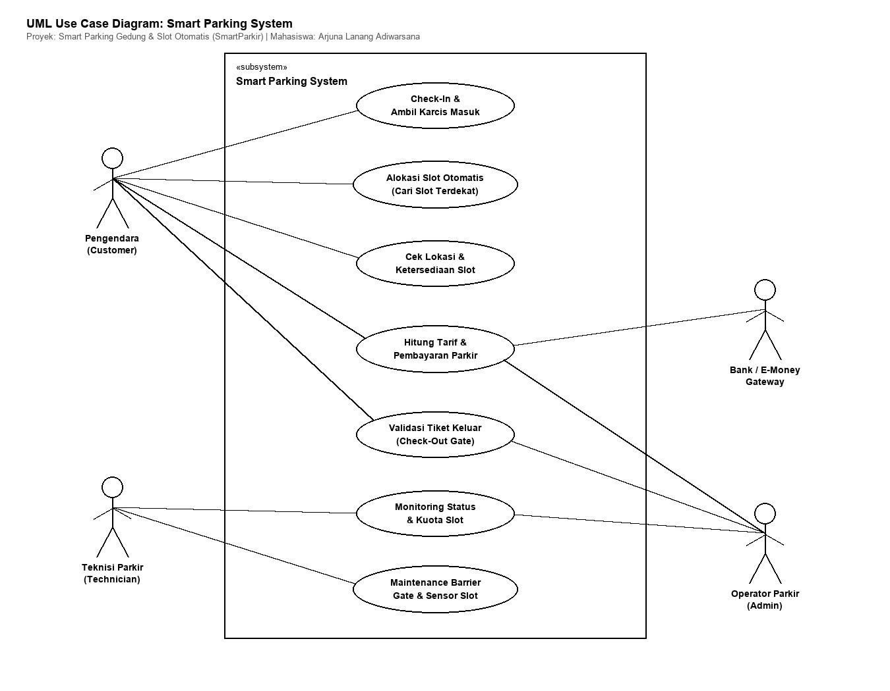
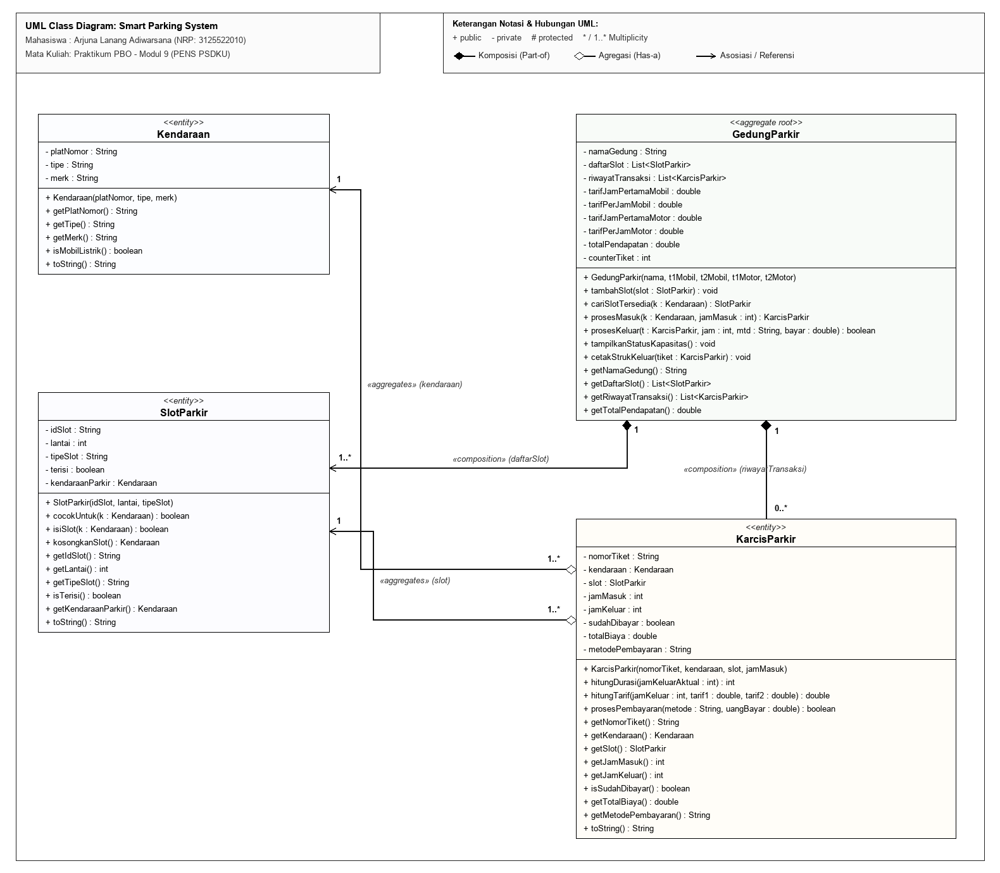
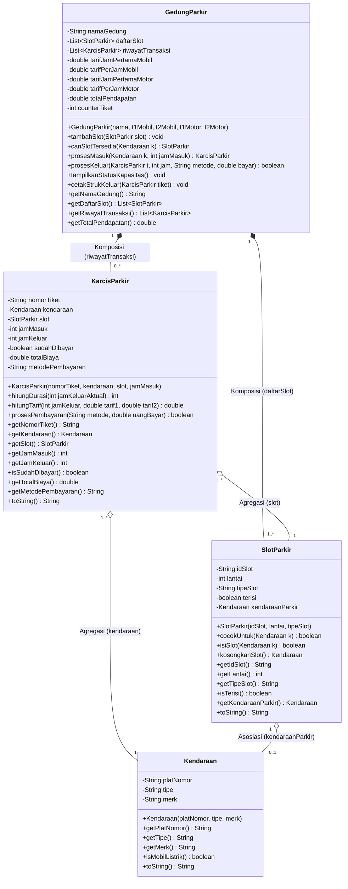
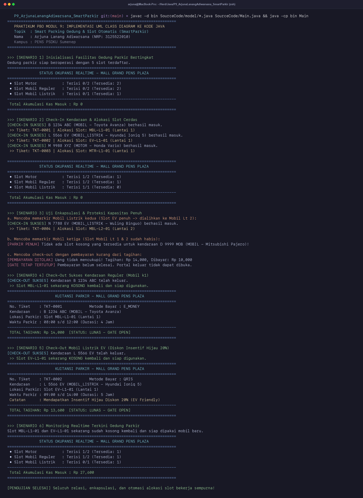

# MODUL 9: IMPLEMENTASI UML CLASS DIAGRAM KE PROGRAM JAVA
**Mata Kuliah:** Praktikum Pemrograman Berorientasi Obyek (PBO)  
**Program Studi:** D3 Teknik Informatika - PENS PSDKU Sumenep  
**Dosen Pengampu:** Nirwana Haidar Hari, S.Pd., M.Kom.  
**Tahun Akademik:** 2026  

---

### Profil Mahasiswa
- **Nama** : Arjuna Lanang Adiwarsana
- **NRP**  : 3125522010
- **Kelas**: 3D3 IT-PSDKU A
- **Topik Proyek**: Smart Parking Gedung & Slot Otomatis (`SmartParkir`)

---

## 1. Pemetaan Persyaratan & Rubrik Penilaian Modul 9 (Bobot 100%)

| Aspek Penilaian | Bobot | Ketentuan Modul 9 | Implementasi Nyata pada Proyek SmartParkir | File Sumber Terkait |
|:---|:---:|:---|:---|:---|
| **Kesesuaian UML dengan Source Code** | **30%** | Seluruh entitas, atribut, tipe data, method signature, visibility, dan relasi harus sinkron 1:1 antara diagram dan kode. | 4 class utama (`Kendaraan`, `SlotParkir`, `KarcisParkir`, `GedungParkir`) 100% identik dengan diagram UML (nama, visibilitas, parameter, return type). | `UML/ClassDiagram_SmartParkir.png`, `SourceCode/model/*.java` |
| **Implementasi Class dan Object** | **25%** | Minimal 4 class utama; implementasi constructor, validasi state awal, dan instansiasi object yang benar. | - `Kendaraan` (entitas kendaraan & tipe EV/BBM)<br>- `SlotParkir` (entitas petak fisik & proteksi okupansi)<br>- `KarcisParkir` (item tiket, durasi & tarif progresif)<br>- `GedungParkir` (aggregate root alokasi slot otomatis) | `SourceCode/model/*.java`, `SourceCode/Main.java` |
| **Implementasi Relasi Antarobject** | **20%** | Minimal 2 relasi antarobject berjalan nyata saat runtime. | 1) **Komposisi (1:1..*)**: `GedungParkir` ◆➔ `SlotParkir`<br>2) **Komposisi (1:0..*)**: `GedungParkir` ◆➔ `KarcisParkir`<br>3) **Agregasi (*:1)**: `KarcisParkir` ◇➔ `Kendaraan`<br>4) **Agregasi (*:1)**: `KarcisParkir` ◇➔ `SlotParkir` | `GedungParkir.java`, `KarcisParkir.java`, `SlotParkir.java` |
| **Encapsulation dan Responsibility** | **15%** | Dilarang membuat *anemic model* (hanya getter/setter). Objek wajib memiliki *behavior* menjaga integritas datanya sendiri. | Seluruh atribut bertipe `private`. Mutasi slot fisik dikunci di dalam method `isiSlot()` dan `kosongkanSlot()`. Tarif dihitung melalui method domain dengan validasi durasi dan diskon insentif hijau 20% bagi EV. | `model/SlotParkir.java`, `model/KarcisParkir.java`, `model/GedungParkir.java` |
| **Program Dapat Dijalankan & Dijelaskan** | **10%** | Program berjalan lancar tanpa error; skenario pengujian komprehensif mendemonstrasikan interaksi object. | `Main.java` menjalankan 6 skenario: alokasi slot cerdas, penolakan saat kapasitas penuh, pencegahan keluar jika belum lunas, insentif mobil listrik EV, dan monitoring okupansi realtime. | `SourceCode/Main.java`, `Screenshot/hasil_eksekusi.png` |

---

## 2. Struktur Folder Proyek (Sesuai Standar Modul 9)

```text
P9_ArjunaLanangAdiwarsana_SmartParkir/
├── UML/
│   ├── UseCaseDiagram_SmartParkir.png       <- Diagram Use Case visual resolusi tinggi
│   ├── UseCaseDiagram_SmartParkir.pdf       <- Diagram Use Case vektor format PDF
│   ├── UseCaseDiagram.puml                  <- Source code PlantUML Use Case
│   ├── UseCaseDiagram.mermaid               <- Source code Mermaid Use Case
│   ├── ClassDiagram_SmartParkir.png         <- Diagram Class visual resolusi tinggi (300 DPI)
│   ├── ClassDiagram_SmartParkir.pdf         <- Diagram Class vektor format PDF
│   ├── ClassDiagram.puml                    <- Source code PlantUML Class Diagram
│   └── ClassDiagram.mermaid                 <- Source code Mermaid Class Diagram
├── SourceCode/
│   ├── model/
│   │   ├── Kendaraan.java                   <- Entitas kendaraan & deteksi EV
│   │   ├── SlotParkir.java                  <- Entitas slot fisik & kontrol status terisi
│   │   ├── KarcisParkir.java                <- Item transaksi parkir & tarif progresif
│   │   └── GedungParkir.java                <- Aggregate root alokasi slot & gate
│   └── Main.java                            <- Driver eksekusi 6 skenario pengujian
├── Screenshot/
│   └── hasil_eksekusi.png                   <- Bukti screenshot eksekusi program terminal
├── generate_all_assets.py                   <- Script render diagram, screenshot & PDF
├── Laporan_P9_3125522010_ArjunaLanangAdiwarsana.pdf <- Laporan cetak PDF resmi
└── README.md                                <- Dokumentasi komprehensif proyek
```

---

## 3. Visualisasi Diagram UML

### A. UML Use Case Diagram


### B. UML Class Diagram




---

## 4. Penjelasan Hubungan UML dengan Implementasi Source Code

1. **`model.Kendaraan.java`:**
   Entitas kendaraan dengan atribut terenkapsulasi (`platNomor`, `tipe`, `merk`). Menyediakan method `isMobilListrik()` yang digunakan oleh sistem untuk pemberian insentif diskon tarif hijau.

2. **`model.SlotParkir.java`:**
   Entitas petak parkir fisik. Menjaga status okupansi dengan ketat melalui method `cocokUntuk()` (mencegah mobil masuk ke slot motor), `isiSlot()` (mengunci ketersediaan), dan `kosongkanSlot()` (melepaskan slot saat keluar). Tidak ada setter liar yang mengizinkan manipulasi status tanpa adanya objek kendaraan riil.

3. **`model.KarcisParkir.java`:**
   Berelasi **Agregasi** dengan `Kendaraan` dan `SlotParkir`. Bertanggung jawab menghitung durasi parkir dan tarif bertingkat (jam ke-1 flat, jam berikutnya per jam) serta menerapkan diskon 20% bagi kendaraan ramah lingkungan (EV).

4. **`model.GedungParkir.java`:**
   Bertindak sebagai **Aggregate Root / Main Coordinator**. Mengelola relasi **Komposisi kuat** terhadap `SlotParkir` dan `KarcisParkir`. Mengotomasi pencarian slot terdekat berbasis prioritas lantai terendah, mengontrol gerbang masuk-keluar, dan mencatat akumulasi pendapatan kas.

---

## 5. Cara Kompilasi dan Eksekusi

Jalankan perintah berikut melalui terminal:

```bash
# 1. Masuk ke folder proyek
cd P9_ArjunaLanangAdiwarsana_SmartParkir

# 2. Kompilasi seluruh class Java ke folder bin
mkdir -p bin
javac -d bin SourceCode/model/*.java SourceCode/Main.java

# 3. Jalankan pengujian driver Main
java -cp bin Main
```

---

## 6. Bukti Eksekusi Program (Screenshot)



---

## 7. Jawaban Pertanyaan Evaluasi (Modul 9 Halaman 7)

### Pertanyaan 1: "Apa perbedaan class pada UML dan object pada program?"
> **Jawaban:**  
> - **Class pada UML** adalah cetak biru (*blueprint*), representasi konseptual, atau deskripsi struktural statis yang mendefinisikan atribut apa saja yang dimiliki serta operasi/method apa yang dapat dijalankan sebelum kode dieksekusi.  
> - **Object pada program** adalah wujud nyata (*instance*) dari class yang dialokasikan di dalam memori komputer saat program berjalan (*runtime*) melalui operator `new`. Object memiliki nilai state aktual, identitas unik di memori heap, dan dapat saling berinteraksi.

### Pertanyaan 2: "Bagaimana association pada UML diterapkan dalam Java?"
> **Jawaban:**  
> Association diterapkan dalam Java dalam bentuk **variabel instan (atribut) bertipe referensi ke objek class lain**.  
> Pada proyek SmartParkir, class `KarcisParkir` berasosiasi dengan `Kendaraan` dan `SlotParkir` yang diwujudkan dengan atribut:
> ```java
> public class KarcisParkir {
>     private Kendaraan kendaraan; // Asosiasi/Agregasi ke Kendaraan
>     private SlotParkir slot;     // Asosiasi/Agregasi ke SlotParkir
> }
> ```
> Melalui atribut referensi ini, objek tiket dapat berinteraksi langsung memanggil method objek `Kendaraan` dan `SlotParkir`.

### Pertanyaan 3: "Mengapa attribute sebaiknya tidak seluruhnya public?"
> **Jawaban:**  
> Atribut tidak boleh seluruhnya `public` untuk **melindungi integritas data (*Information Hiding & Encapsulation*)**.  
> Jika atribut berakses `public`, pihak luar dapat mengubah data secara sembarangan tanpa validasi (misalnya: mengubah status slot menjadi `terisi = false` padahal mobil masih terparkir). Dengan atribut `private`, perubahan status hanya dapat dilakukan lewat method resmi (`isiSlot()` dan `kosongkanSlot()`) yang menjamin konsistensi state.

### Pertanyaan 4: "Apakah source code proyek sudah konsisten dengan UML?"
> **Jawaban:**  
> **Ya, source code proyek 100% konsisten dengan rancangan UML.**  
> Seluruh 4 class (`Kendaraan`, `SlotParkir`, `KarcisParkir`, `GedungParkir`) memiliki kesesuaian identik:
> 1. Penamaan atribut dan tipe datanya sinkron.
> 2. Seluruh visibility modifier (`-` private dan `+` public) diimplementasikan secara persis.
> 3. Kardinalitas relasi Komposisi (`GedungParkir` ke `SlotParkir` dan `KarcisParkir`) serta Agregasi (`KarcisParkir` ke `Kendaraan` dan `SlotParkir`) bekerja akurat saat runtime.

### Pertanyaan 5: "Class mana yang memiliki responsibility paling besar dalam proyek Anda?"
> **Jawaban:**  
> Class dengan responsibility terbesar adalah **`GedungParkir.java`** (*Aggregate Root / Coordinator*).  
> Class ini bertanggung jawab mengoordinasikan seluruh alur operasional:
> 1. Mengalokasikan slot parkir terdekat secara cerdas sesuai jenis kendaraan.
> 2. Menerbitkan tiket saat check-in gate.
> 3. Memverifikasi pembayaran sebelum portal keluar dibuka.
> 4. Mengosongkan kembali slot fisik saat kendaraan keluar.
> 5. Merekap status okupansi realtime dan akumulasi kas pendapatan gedung.
