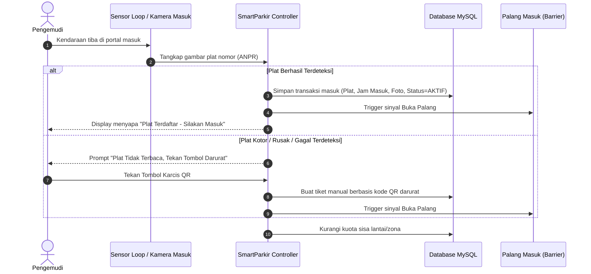
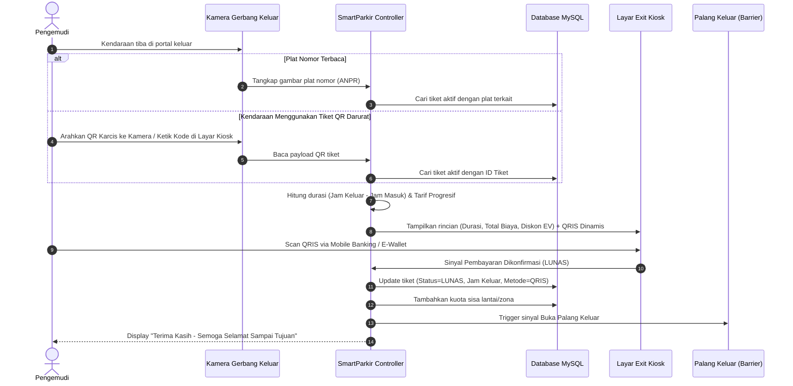

# Design Document: SmartParkir 2.0 (Real-World Manless & Ticketless Smart Parking System)

- **Date:** 2026-11-09
- **Author:** Arjuna Lanang Adiwarsana & AI Assistant
- **Status:** Final Draft (Reviewed & Ready for Approval)
- **Repository:** `P9_ArjunaLanangAdiwarsana_SmartParkir`

---

## 1. Intent and The Why

Sistem parkir konvensional di Indonesia (berbasis karcis kertas dan loket kasir manual) menghadapi tiga masalah besar di dunia nyata:
1. **Kemacetan di Gerbang Masuk & Keluar**: Waktu tunggu mencetak karcis fisik dan pembayaran tunai dengan uang kembalian memakan waktu 30–60 detik per kendaraan.
2. **Karcis Kertas Hilang & Denda Fiktif**: Pengemudi sering kehilangan karcis fisik sehingga menimbulkan perdebatan denda karcis hilang dan potensi kecurangan operasional.
3. **Biaya Tenaga Kerja Operator Booth**: Menempatkan petugas kasir di setiap pos gerbang 24/7 membebani biaya operasional pengelola gedung.

Sebelumnya, proyek SmartParkir dirancang sebagai implementasi akademik PBO Modul 9 dengan asumsi simulasi: gerbang masuk mendikte pengemudi harus parkir di slot petak tertentu (misal `MBL-L1-01`), dan gerbang keluar mengandalkan kasir yang mengklik tiket manual di desktop GUI. Di dunia nyata, asumsi ini tidak masuk akal karena pengemudi bebas memilih petak parkir di dalam gedung, dan mall modern sudah beralih ke sistem otomatis (*manless*).

**Tujuan Redesain SmartParkir 2.0:** Mengubah sistem menjadi sistem parkir otomatis mandiri (*manless & ticketless*) berbasis Automatic Number Plate Recognition (ANPR/ALPR), kuota dinamis berbasis zona/lantai, dan pembayaran digital QRIS dinamis di gerbang keluar tanpa operator.

---

## 2. Goals, Non-Goals, and Anti-Goals

### Goals
1. **Entrance Gate Manless (Ticketless)**:
   - Kamera membaca plat nomor secara otomatis saat mobil berhenti di portal masuk.
   - Jika plat terbaca, sistem mencatat transaksi masuk ke database dan palang terbuka otomatis (plat nomor menjadi ID karcis).
   - Tampilan layar luar (Entrance Kiosk) menyapa pengemudi: nomor plat, jenis kendaraan, dan sisa kapasitas lantai/zona.
   - **Fallback Gate Masuk**: Jika plat kotor/rusak, pengemudi menekan tombol darurat untuk mencetak karcis QR kecil berdurasi instan.
2. **Dynamic Zone & Floor Capacity Engine**:
   - Menghilangkan ilusi mendikte nomor petak individual. Sistem mengelola kuota agregat per lantai (`Kapasitas Maksimal - Kendaraan Aktif di Zona`).
   - Menyediakan data real-time sisa petak untuk papan VMS (*Variable Message Sign*).
3. **Exit Gate Manless (Digital Autopay via Midtrans Sandbox)**:
   - Kamera exit membaca plat nomor yang sama, mencocokkan waktu masuk di database.
   - Sistem menghitung durasi parkir dan tarif progresif secara otomatis (termasuk insentif diskon 20% bagi mobil listrik EV).
   - Sistem memanggil **Midtrans Core API (Sandbox)** untuk menghasilkan transaksi QRIS resmi (`payment_type: qris`).
   - Layar Exit Kiosk menampilkan gambar QR Code dari Midtrans (serta payload `qr_string` asli yang bisa di-scan/disimulasikan di Midtrans QRIS Simulator).
   - Polling background otomatis memeriksa status transaksi ke Midtrans (`GET /v2/{order_id}/status`) hingga berstatus `settlement`, dengan tombol simulasi lokal sebagai fallback.
4. **Instant Payment & Automatic Gate Actuation**:
   - Sistem mendeteksi pelunasan QRIS (simulasi pembayaran instan via polling/webhook).
   - Begitu lunas, palang keluar otomatis terangkat, struk digital dikirim via QR/unduh, dan foto audit keluar disimpan.
5. **Central Monitoring Console**:
   - Menyediakan tampilan dashboard pengawas untuk memantau antrean gerbang masuk/keluar, log transaksi real-time, dan status palang serta kamera.

### Non-Goals
- Tidak memasang sensor fisik IoT ultrasonik di setiap satu per satu petak slot lantai pada fase ini (menggunakan pelacakan kuota agregat zona).
- Tidak menyediakan mesin pemroses uang tunai kertas (*cash acceptor / dispenser kembalian*), murni sistem nir-sentuh digital (Cashless / QRIS).

### Anti-Goals
- **Dilarang mendikte nomor petak spesifik ke pengemudi** di gerbang masuk (karena di dunia nyata pengemudi parkir bebas di zona yang tersedia).
- **Dilarang mengandalkan kasir manual** untuk mengetik plat nomor atau menghitung kembalian uang tunai.
- **Dilarang bergantung pada LLM cloud yang lambat (>2 detik)** untuk membuka palang pintu utama; engine deteksi harus responsif dengan opsi fallback lokal.

---

## 3. Constraints

1. **Kompatibilitas Akademik Modul 9 PBO**:
   - Struktur 4 class inti domain (`Kendaraan`, `SlotParkir`, `KarcisParkir`, `GedungParkir`) tetap dipertahankan dan selaras dengan UML Class Diagram dan Use Case Diagram agar nilai mata kuliah PBO tetap valid.
2. **Teknologi Stack**:
   - Bahasa: Java SE 17+
   - Database: MySQL (didukung fallback SQLite/In-Memory untuk demonstrasi portabel).
   - UI: Java Swing Modern (Dark Workstation / Flat Matte UI) dengan 2 tampilan utama:
     - `KioskGateView` (Layar sentuh outdoor gerbang: Mode Masuk & Mode Keluar).
     - `SupervisorConsoleView` (Dashboard pengawas operasional gedung).
3. **Kamera & AI Service**:
   - Mendukung integrasi kamera live streaming (webcam/IP Cam RTSP/MJPEG) atau unggah gambar sampel dengan simulasi sensor kedatangan kendaraan.

---

## 4. Evaluated Approaches & Selection

Tiga pendekatan telah dievaluasi bersama pengguna:

| Pendekatan | Deskripsi | Kelebihan | Trade-off / Alasan Ditolak |
|---|---|---|---|
| **Pendekatan 1: Ticketless ANPR + Dynamic QRIS Manless (DIPILIH)** | Kamera masuk otomatis rekam plat, portal terbuka tanpa kertas. Kamera keluar deteksi plat, hitung tarif, tampilkan QRIS dinamis, palang terangkat setelah bayar. | Paling hemat kertas, menghilangkan 100% kasir fisik, sesuai tren mall & bandara modern Indonesia. | Membutuhkan integrasi QRIS dinamis di layar gate dan fallback tombol darurat jika plat kotor. |
| **Pendekatan 2: Pay-on-Foot / Kios Mandiri** | Pengemudi ambil tiket di gerbang, lalu bayar di mesin Kios Lobi sebelum ke mobil, gerbang keluar hanya scan tiket lunas. | Arus kendaraan keluar sangat cepat tanpa proses bayar di portal. | Memerlukan pembuatan 2 sistem terpisah (Kios Lobi + Gerbang Keluar) dan tetap menggunakan tiket fisik. |
| **Pendekatan 3: Dedicated RFID Gate** | Sistem gerbang tertutup berbasis kartu RFID/KTM tanpa tarif umum (sistem akses member). | Sangat cepat untuk civitas kampus. | Tidak bisa digunakan untuk parkir komersial umum/tamu yang tidak memiliki kartu member terdaftar. |

**Keputusan:** Pengguna memilih **Pendekatan 1 (Ticketless ANPR + Dynamic QRIS Manless Gate)**.

---

## 5. Architectural & Behavioral Specification

### A. Alur Gerbang Masuk (Entrance Gate Workflow)

### B. Alur Manajemen Kuota Dinamis (Zone Capacity Engine)
- Setiap lantai gedung memiliki kuota kapasitas (misal: Lantai 1 = 20 mobil, Lantai 2 = 30 mobil, Dedicated EV = 5 mobil).
- Ketika kendaraan masuk, sistem mengalokasikan kuota ke zona yang sesuai berdasarkan tipe kendaraan (`MOBIL`, `MOBIL_LISTRIK`, `MOTOR`).
- Display Entrance Kiosk menampilkan:
  - `TOTAL TERSISA: XX Slot`
  - `LANTAI 1: XX Slot` | `LANTAI 2: XX Slot` | `EV CHARGER: XX Slot`
- Pengemudi memilih petak bebas secara mandiri di dalam area tanpa intervensi sistem.

### C. Alur Gerbang Keluar & Pembayaran Digital (Exit Gate Workflow)

### D. Tampilan Antarmuka & Topologi Runtime
1. **Topologi Proses (Single JVM Terpadu)**:
   - Seluruh sistem berjalan dalam satu proses JVM Java Swing yang stabil dan ringan.
   - Menggunakan model antarmuka modular dengan navigasi cepat:
     - **Mode Layar Gerbang Masuk (Entrance Kiosk View)**: Mensimulasikan terminal luar tempat mobil masuk, feed ANPR, indikator sisa slot lantai, tombol darurat QR.
     - **Mode Layar Gerbang Keluar (Exit Kiosk View)**: Mensimulasikan terminal pembayaran luar, feed ANPR exit, render QRIS interaktif, kalkulasi tarif real-time, status palang.
     - **Mode Konsol Pengawas (Supervisor View)**: Monitoring live transaksi, rekap pendapatan harian, dan tombol *Manual Override Emergency Gate*.
2. **Strategi Kuota Lantai Virtual (Waterfall Allocation)**:
   - Mengisi kapasitas Lantai 1 terlebih dahulu hingga penuh sebelum mengalokasikan ke Lantai 2, menjaga kepatuhan relasi komposisi `GedungParkir -> SlotParkir` pada modul akademik PBO Modul 9 tetap 100% valid tanpa cacat penilaian.

---

## 6. What's Left to The Builder

1. **Implementasi UI Gate Kiosk (Entrance & Exit)**:
   - Menyediakan tampilan Swing yang mensimulasikan layar terminal gerbang manless (terpisah dari meja kasir konvensional).
2. **Komponen Generator QR Code & Simulasi Pembayaran QRIS**:
   - Menghasilkan visual QR Code dinamis berbasis string payload transaksi (misal format QRIS standar/simulasi).
   - Menyediakan tombol simulasi "Bayar QRIS (Customer Mobile App)" untuk pengujian cepat tanpa gateway bank sesungguhnya.
3. **Refactoring Logika GedungParkir**:
   - Mengalihkan fokus alokasi dari "penentuan nomor petak kaku" menjadi "penghitungan kuota zona/lantai yang fleksibel".
4. **Audit Trail & Logging**:
   - Memastikan setiap aksi buka palang tercatat dengan rapi di database MySQL beserta waktu dan plat nomor.
